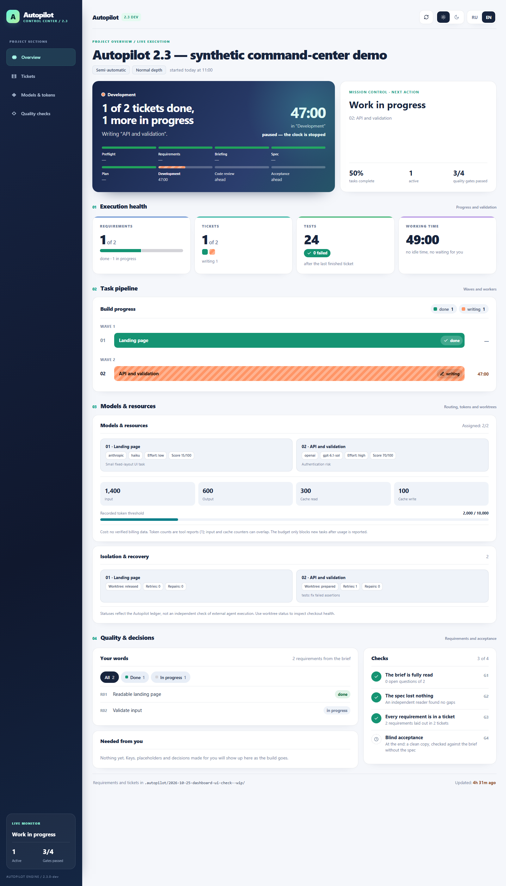
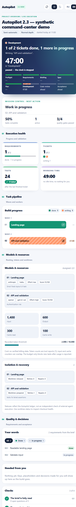

<h1 align="center">Autopilot 2.3 <sup>DEV</sup></h1>

<p align="center"><a href="https://github.com/mrAibo/Autopilot">GitHub: mrAibo/Autopilot</a></p>

<p align="center"><strong>Beschreibe, was entstehen soll – Autopilot organisiert die Umsetzung und prüft das Ergebnis.</strong></p>

<p align="center"><a href="README.md">English</a> · <a href="README.ru.md">Русский</a> · <b>Deutsch</b></p>

Autopilot ist ein **Skill für KI-gestützte Softwareentwicklung**. Aus einer
Projektbeschreibung erstellt er nachvollziehbare Anforderungen, klärt offene
Entscheidungen, formuliert eine Spezifikation, plant Arbeitspakete, organisiert
deren Ausführung und kontrolliert die Abnahme. Ziel ist, dass Anforderungen
aus der ursprünglichen Beschreibung nicht unterwegs verloren gehen.

> **Cargo-Testprüfung nach 2.3.0:** Der aktuelle Entwicklungsstand unterstützt [eingeschränkte, hostseitig geprüfte Offline-Cargo-Integrationstests](docs/autopilot/trusted-cargo-tests.md) für eigenständige Rust-Crates ohne externe Abhängigkeiten. Manifest, Lockdatei und Test müssen unverändert zur Git-Basis passen; keine freie Befehlsausführung oder Sandbox-Garantie.

> **Read-only Prüfung bestehender Projekte:** Die [Git-Vorabprüfung](docs/autopilot/repository-preflight.md) meldet Hindernisse für isolierte Aufgaben, ohne Dateien zu ändern oder Dateinamen auszugeben. Diese Funktion gehört zu Autopilot und ist unabhängig von anderen Projekten.

> **Model-only Routing (nach 2.3):** Wenn der Host das exakte Agentenmodell sicher festlegen kann, aber den Effort nicht, erlaubt `effort_selection:false` native Profile ohne Effort. Die Effort-Empfehlung bleibt unverifiziert; Modell, benannter Agent und echte Host-Unterstützung müssen weiterhin geprüft werden. Dadurch werden fehlende native Codex-GUI-Agenten **nicht** freigeschaltet. Siehe [Modellrouting](docs/autopilot/model-routing.md).

> **Automatische Modellauswahl in Phase 4:** `ap.py plan-models` berechnet für **jedes Ticket** Modell und Reasoning Effort nach Komplexität und Risiko. `--apply` registriert Profile gesammelt nur bei bestätigten Host-Fähigkeiten. Siehe [Modellrouting](docs/autopilot/model-routing.md); die tatsächliche GUI-Ausführung ist damit nicht nachgewiesen.

> **Sicherer sequenzieller Modus:** [Ein Ticket, separater Git-Worktree, unabhängige Tests](docs/autopilot/sequential-host.md). Kein benannter Subagent und kein Nachweis über das tatsächliche GUI-Modell, Effort oder Kosten.

> **Release-Freigabe:** [Prüfmatrix R01–R06](docs/autopilot/release-readiness.md) mit tatsächlichen Nachweisen, offenen GUI-Einschränkungen und den Bedingungen für die stabile Version.

> **Autopilot 2.3.0 — eingeschränkter Codex-Release:** unterstützt wird der sequenzielle Modus mit Git-Worktrees und hostseitigen Python-Unittests; **nicht** garantiert sind native GUI-Subagenten, tatsächliche Modell-/Effort-Durchsetzung oder Abrechnung.

> **Autopilot 2.4.0 — Claude Code.** Claude Code mit Abonnement wird im strikten Routing-Modus unterstützt und wurde live in der Desktop-App und in der Terminal-CLI (headless `claude -p`) qualifiziert: siehe [claude-code.md](docs/autopilot/claude-code.md) und die [Qualifikationsergebnisse](docs/autopilot/claude-qualification.md). Bekannte Grenzen:
> - parallele Tickets sind nur mit `--isolated-tickets` (Autopilot-Worktrees) live getestet; im gemeinsamen Baum einzeln ausführen;
> - `/subtask` und `/fork` nicht während strikter Tickets verwenden;
> - ein eigener `ANTHROPIC_BASE_URL`-/`ANTHROPIC_MODEL`-Router ändert, was ausgeführt wird und was die Attestierung sieht.
> Der Zustand ist in [STATUS.md](STATUS.md) dokumentiert. Die ursprünglichen
> Anforderungen dieser Weiterentwicklung stehen in [brief.md](brief.md).
> Die korrekte Ausführung namentlich zugewiesener Subagenten in der
> Codex-GUI sowie echte Einsparungen bei Modell-Tokens sind noch nicht
> vollständig nachgewiesen. Optionale API-Experimente sind für
> `/autopilot` **nicht erforderlich**.

<p align="center">
  <a href="assets/dashboard-31-desktop.png"></a>
  <a href="assets/dashboard-31-narrow.png"></a>
</p>

<p align="center"><sub>Dashboard 3.1 · Demonstration mit synthetischen Daten · Oberfläche derzeit auf Russisch und Englisch</sub></p>

Das Dashboard zeigt den Fortschritt, offene Fragen, Arbeitspakete,
Anforderungen, Prüfungen und den aktuellen Zustand. Es läuft als lokale
HTML-Seite und benötigt keine Internetverbindung für seine Anzeige.
Die Darstellung wurde auch für schmale Ansichten von **390 und 460
CSS-Pixeln** geprüft. Eine neue Skill-Version aktualisiert bereits
kopierte Projekt-Dashboards **nicht automatisch**:
[sichere Aktualisierung](docs/autopilot/gui-clients.md).

---

## Installation

Wer Autopilot bereits global als verknüpften Entwicklungsskill
verwendet, muss ihn nicht erneut installieren. Auf einem anderen
Computer kann der Agent die Installation übernehmen.

### Installation durch den KI-Agenten

Öffne Codex, Claude Code oder einen anderen kompatiblen Agenten und
kopiere diese Anweisung:

```text
Installiere für mich den Skill Autopilot mit diesem Befehl:

npx skills add mrAibo/Autopilot --skill autopilot -g -y -a <dein Agent: claude-code, cursor, codex>

Falls npx nicht verfügbar ist, zeige mir den Link zur Node.js-Installation
und halte an. Installiere nichts Weiteres.
Danach melde kurz, ob die Installation erfolgreich war und ob ich
die Agentensitzung neu starten muss.
```

Alternativ im Terminal:

```bash
npx skills add mrAibo/Autopilot
```

Für eine unbeaufsichtigte Installation in Claude Code:

```bash
npx skills add mrAibo/Autopilot --skill autopilot -a claude-code -g -y
```

`-g` installiert global, `-a` bestimmt den Agenten und `-y` bestätigt
Installationsfragen. Ohne `-g` gilt die Installation nur für das
aktuelle Projekt. Benötigt werden Node.js für `npx` und ein geeigneter
Agent. Nach der Installation muss die Agentensitzung gegebenenfalls
neu gestartet werden, damit der Skill erkannt wird.

**Wichtig:** Die installierte veröffentlichte Version und ein direkt
verknüpfter `2.3.0-dev`-Checkout sind nicht zwingend identisch.
Den aktuellen Stand zuerst prüfen; eine verknüpfte Entwicklerkopie
nicht mit einem globalen Update überschreiben.

---

## Ein neues Projekt starten

Öffne den Agenten **im gewünschten Projektordner** und gib die Aufgabe ein:

```text
/autopilot Baue einen Telegram-Bot, der Reparaturanfragen annimmt
und die Einträge in einer Google-Tabelle speichert.
```

Autopilot startet nicht ungefragt: Der ausdrückliche Aufruf
`/autopilot` aktiviert die Arbeit. Umfangreiche Anforderungen können
auch in einer lokalen Datei stehen:

```text
/autopilot brief.md
```

Oder mit einer zusätzlichen Einschränkung:

```text
/autopilot deep docs/idea.md – keine echten Zahlungen auslösen
```

Die Originaldatei bleibt erhalten. Der Agent bewahrt im Projekt eine
Fassung der Anforderung für die spätere unabhängige Prüfung auf.
Fragen zu echten Entscheidungsalternativen stellt er in Runden;
in der Standardeinstellung sind es nur die notwendigen.

## Ein vorhandenes Projekt weiterentwickeln

**Ein bestehendes Repository muss nicht neu aufgebaut werden.**
Öffne den Agenten im **Wurzelverzeichnis der bestehenden Anwendung**,
nicht im Quellcode-Verzeichnis des Autopilot-Skills. Formuliere
die neue Funktion oder Korrektur:

```text
/autopilot Ergänze die bestehende Anwendung um einen CSV-Export.
Erhalte die vorhandene API, die Datenbank, bestehende Tests und Nutzerdaten.
```

Oder lege die Beschreibung im Projekt ab und nutze
`/autopilot brief.md`. Der Projektagent soll zunächst:

1. Repository, Git-Verlauf und **nicht commitete Änderungen** prüfen.
2. `AGENTS.md` beziehungsweise `CLAUDE.md`, vorhandene
   Architekturentscheidungen, Lauf- und Testbefehle lesen.
3. Vorhandenen Code und Schnittstellen als Ausgangspunkt benutzen und
   nur Anforderungen für die **gewünschte Erweiterung** erfassen.
4. Kein bestehendes Projekt neu initialisieren, nichts ungefragt löschen,
   überschreiben, stashen, zurücksetzen oder fremde Änderungen committen.
   Bei irreversiblen Schritten vorher um Erlaubnis bitten.

Existiert bereits `.autopilot/state.js`, muss der Agent **zuerst
dessen Zustand ermitteln**:

| Zustand | Richtige Fortsetzung |
|---|---|
| Kein Autopilot-Zustand vorhanden | Neuen Lauf **im bestehenden Codeprojekt** beginnen |
| Ein Lauf ist noch nicht abgeschlossen | Vorhandenen Lauf **wiederaufnehmen**, keinen neuen `init` ausführen |
| Der frühere Lauf ist abgeschlossen | Neue Erweiterung als neuen Lauf planen |
| Der abgeschlossene Lauf soll ausdrücklich ergänzt werden | Den dokumentierten `reopen`-Weg benutzen; erledigte Tickets behalten |
| Eine andere Sitzung arbeitet noch am Lauf | **Nicht** mit einem zweiten schreibenden Agenten fortfahren |

Die historische Projektarbeit bleibt dabei erhalten. Das Dashboard
des bereits konfigurierten Projekts kann bei Bedarf separat und ohne
Zurücksetzen der Tickets aktualisiert werden:
[Dashboard-Aktualisierung](docs/autopilot/gui-clients.md).

## Nach einer Unterbrechung: So arbeitet der Projektagent weiter

**Der Agent startet nach einem Abbruch nicht selbstständig im
Hintergrund neu.** Wenn der Chat geschlossen wird, das Kontextfenster
voll ist, das Terminal abstürzt oder die Verbindung abbricht,
öffne eine **neue Sitzung im selben Projektordner** und gib ein:

```text
/autopilot
```

Die folgenden Schritte erledigt der **Projektagent** – nicht die
Nutzerin oder der Nutzer. Maßgeblich ist die verbindliche
[Recovery-Anleitung des Skills](skills/autopilot/phases/0-resume.md):

1. **Zustand einlesen:** `.autopilot/state.js`, zugehöriges
   `AGENTS.md` / `CLAUDE.md`, `manifest.md`, datierte
   `*-brief.md`-Dateien, `interfaces.md`, Tickets und aktuelle Phase.
   `.autopilot/PROGRESS.md` liefert ergänzende Hinweise, ersetzt aber
   nicht den aktuellen Laufzustand.
2. **Git und Aufgaben prüfen:** `git status` und
   `python3 .autopilot/ap.py commits` prüfen, ob die Commits bereits
   abgenommener Tickets noch zur aktuellen Git-Historie gehören.
   Angefangene Arbeitspakete und isolierte Worktrees erst untersuchen,
   dann bei Bedarf den **Ticketstatus** zurücksetzen – niemals
   unkontrolliert Quellcode verwerfen oder halbfertige Änderungen
   ohne Tests übernehmen.
3. **Dashboard wiederherstellen:** Den lokalen Server erneut starten
   und die Dashboard-Ansicht in der neuen Sitzung öffnen. Die
   aktuelle Phase, erledigte Arbeit und nächste Aktion knapp melden.
4. **Von der letzten geprüften Stelle fortfahren:** Vor dem nächsten
   Ticket die vorhandenen Projekttests ausführen, abgeschlossene
   Phasen nicht wiederholen und bereits gespeicherte Antworten nicht
   erneut abfragen. Fehlt eine notwendige, nie dokumentierte
   Entscheidung, wird **nur diese** nachgefragt.

**Kein zweiter gleichzeitiger Schreiber:** Zeigt der Zustand eine
bereits aktive Sitzung, darf ein zweiter Agent nicht denselben
`state.js` bearbeiten. Die Dateien `.autopilot/` und
`state.js` bleiben unverändert; kein `git reset --hard` und kein
neuer `init` als vermeintliche Reparatur.

Gespeicherte Dateien, Git-Commits und überprüfte Ergebnisse können
wiedergefunden werden. **Ungespeicherte Gedanken, temporäre
Modellantworten oder nie persistierte Werkzeugaufrufe lassen sich
nicht rekonstruieren.** Hat der Agent keinen Zugriff mehr auf die
Projektdateien, muss er das offen melden.

Die Unterscheidung zwischen neuem Lauf und Wiederaufnahme ist in
[Phase 0](skills/autopilot/phases/0-preflight.md) beschrieben;
für isolierte Git-Arbeitsbäume gelten die
[Worktree-Recovery-Regeln](docs/autopilot/worktrees.md).

---

## Vier Betriebsarten

Der Standard ist `semi`. Der Modus regelt, **wie viele Entscheidungen
der Nutzer selbst treffen möchte**.

| Modus | Aufruf | Verhalten |
|---|---|---|
| **Vollautomatisch** | `/autopilot full ...` | Keine gewöhnlichen Rückfragen, getroffene Annahmen werden dokumentiert |
| **Halbautomatisch (Standard)** | `/autopilot ...` | Rückfragen nur bei echten offenen Entscheidungen |
| **Interview** | `/autopilot interview ...` | Systematische Klärung, danach selbstständige Umsetzung |
| **Manuell** | `/autopilot manual ...` | Zusätzlich Freigabe von Spezifikation und Ticketplan |

Beispiele:

```text
/autopilot full Eine Landingpage für einen Pizzaservice
/autopilot interview Ein Buchungsportal für Arzttermine
/autopilot manual Eine bestehende CRM-Anwendung erweitern
```

Kein Modus erlaubt ungefragte Zahlungen, Veröffentlichungen,
Löschungen, externe Nachrichten oder das Entfernen von Anforderungen.
Solche Entscheidungen müssen ausdrücklich bestätigt werden.

## Drei Tiefenstufen

Die Tiefe bestimmt, **wie ausführlich Anforderungen ausgearbeitet
werden**. Sie ist vom Modus unabhängig.

| Tiefe | Aufruf | Bedeutung |
|---|---|---|
| **Strict** | `/autopilot strict ...` | Keine nicht bestellten Funktionen; notwendige Fehlerfälle bleiben berücksichtigt |
| **Normal (Standard)** | Ohne Zusatz | Offensichtliche Lücken schließen, keine eigenständige Produktneuerfindung |
| **Deep** | `/autopilot deep ...` | Eingaben, leere Zustände, Abbruch, Wiederaufnahme, Rechte, Wachstum und Fehler konsequent durchdenken |

Eigene Vorschläge des Agenten müssen einer ursprünglichen Anforderung
zugeordnet und im Bericht ausgewiesen sein. Nur der Nutzer darf
Anforderungen streichen.

---

## Der Entwicklungsablauf

| Phase | Was geschieht? |
|---|---|
| **Vorbereitung** | Bestehendes Projekt und Git prüfen, Erinnerung und Dashboard einrichten |
| **Anforderungen** | Originalbeschreibung in nummerierte, nachvollziehbare Anforderungen überführen |
| **Briefing** | Wirkliche Unklarheiten und notwendige Entscheidungen klären |
| **Spezifikation** | Szenarien, Grenzen und Schnittstellen festhalten |
| **Planung** | Geeignete Tickets, Abhängigkeiten, Arbeitsbereiche und Prüfkriterien erstellen |
| **Entwicklung** | Arbeitspakete durch geeignete Ausführungsagenten umsetzen lassen |
| **Code-Review** | Tests, Codequalität, Architektur und Sicherheit prüfen |
| **Abnahme** | Gegen die Originalbeschreibung prüfen und verständlichen Abschlussbericht erstellen |

Anforderungen werden in vier Qualitätsprüfungen verfolgt:
**G1** (Anforderungen verstanden), **G2** (Spezifikation vollständig),
**G3** (Tickets decken Anforderungen ab), **G4** (unabhängige
Schlussabnahme). Ein fehlgeschlagenes Gate darf nicht übergangen
werden, nur damit das Dashboard „fertig“ anzeigt.

Subagentenmodelle und Reasoning-Stufen werden anhand lokaler
Richtlinien und überprüfter Host-Fähigkeiten vorgeschlagen.
**Wichtig:** Die Existenz einer Profil-Datei oder ein grüner
Offline-Test beweist noch nicht, dass Codex GUI oder Claude Code
diesen Subagenten tatsächlich gestartet hat. Für Claude Code
(Desktop-App) wurde das in der T13-Qualifikation live geprüft;
für Codex GUI ist es weiterhin zu verifizieren.

Weitere technische Details:
[Modell-Routing](docs/autopilot/model-routing.md),
[Git-Worktrees](docs/autopilot/worktrees.md),
[Qualitäts- und Produktumfang](docs/autopilot/scope-and-labs.md).

### Zur Aufteilung in Tickets

Jedes Ticket ist ein eigener Agent, der sich neu in das Projekt einarbeiten muss: Verträge lesen, Code studieren, den Stack verstehen. Das ist teuer. Autopilot teilt deshalb nach Codeumfang auf, nicht nach „je kleiner, desto sicherer“: Ein Agent schreibt etwa 3.000 Zeilen samt Tests.

| Umfang | Anzahl Tickets |
|---|---|
| Bis ca. 3.000 Zeilen: Landingpage, Formular, Skript, Änderungsliste für ein bestehendes Projekt | **eines.** Ein Agent baut alles in einem Durchgang, wie in einem normalen Dialog |
| ca. 3–6.000 | 2 |
| ca. 6–18.000 | 3–6, eines pro ca. 3.000 Zeilen |
| ca. 18–36.000 | 7–12 |

Mehr als 12 sind nicht erlaubt: Die Arbeit wird auf zwei Läufe verteilt. Feine Aufteilung kauft keine Zuverlässigkeit, sondern Kosten.

Auch am anderen Ende gibt es eine Grenze. Bei jedem Schritt liest ein Agent seinen gesamten Kontext neu aus dem Cache, ein Ticket wird pro Schritt also teurer, je länger es läuft. Etwa 3.000 Zeilen entsprechen grob 300–400.000 Token Kontext: Danach ist ein frischer Agent günstiger als ein langer.

### Zur Entwicklung

| Was Autopilot tut | Warum |
|---|---|
| Jedes Ticket bearbeitet ein eigener Agent | Er verliert sich nicht im angesammelten Kontext und zerstört nichts, was funktionierte |
| Gibt dem nächsten Agenten die Verträge früherer Tickets mit | Sonst erfindet Ticket sechs neu, was Ticket drei gebaut hat |
| Unabhängige Tickets laufen parallel, mehrere Agenten gleichzeitig | Auf Unabhängiges nacheinander zu warten kostet Stunden |
| Ein Commit pro Ticket | Ihre Rücksetzpunkte |
| Tickets mit gemeinsamen Dateien laufen nacheinander | Sonst überschreiben sich zwei Agenten gegenseitig |
| Vollständige Prüfung nach jedem Ticket: Tests, Typen, Linter | Eine Regression kostet eine Minute, nicht einen Abend |
| Routineaufgaben gehen an ein günstigeres Modell, Fundament und riskante Teile an ein starkes | Das starke Modell wird dort bezahlt, wo es etwas ändert |
| Review am Ende; separat nur Fundament und eine enge Liste von Risiken, parallel, ohne den Bau zu stoppen, höchstens eine Nachprüfung | Das Review fraß früher bis zur Hälfte der Kosten, und eine Prüfung nach jedem Ticket hielt den Bau 15–40 Minuten auf; die früh lohnenden Fehler liegen im Fundament und im Code für Anmeldung, Schlüssel, Geld und Löschen |
| Korrekturen nach dem Review macht derselbe Agent, der den Code schrieb | Er weiß, warum der Code so ist; ein anderer behandelt das Symptom und zerstört die Ursache |
| Die Hauptsitzung schreibt gar keinen Code, sie verteilt und prüft nur | Ihr Kontext ist einer für den ganzen Lauf und wird nie erneuert: Jeder bei Ticket zwei gelesene Diff stört bei Ticket acht |
| Gescheitertes Ticket: Wiederholung, dann ein anderer Weg | Scheitert auch das, hält der Agent an und erklärt es in einfachen Worten |
| Ein vom Code abweichender Plan wird laut korrigiert | Zeigt sich unterwegs, dass der Plan nicht trägt, korrigiert der Agent ihn und sagt es in einer Zeile, statt still etwas anderes zu bauen |

### Sparsamer arbeiten

- **Modell der Hauptsitzung.** Starten Sie `/autopilot` mit Sonnet. Opus nur nach Wunsch für Briefing, Spezifikation und Plan; vor der Bauphase mit `/model` zurückwechseln. Die Hauptsitzung läuft den ganzen Durchlauf und liest bei jedem Schritt ihren wachsenden Kontext neu, sie ist deshalb der größte Kostenposten. In einem kleinen gemessenen Lauf (3 Tickets, Claude-Desktop-App, OpenTelemetry-Schätzung) kostete die Hauptsitzung auf Opus etwa 1,40 USD, alle drei Subagenten zusammen etwa 0,054 USD, also rund 96 % der Schätzung; ein zweiter Lauf (2 Tickets, Terminal, Opus) kam auf etwa 1,20 USD. Das sind `cost.usage`-Schätzungen, keine Abrechnung des Abos, aus zwei kleinen Läufen; bei größeren Projekten wächst der Anteil der Subagenten.
- **Budget.** `python3 .autopilot/ap.py budget --tokens N` verhindert den Start neuer Tickets, sobald die bekannten Ein- und Ausgabe-Tokens N erreichen.
- **Messen.** `python3 skills/autopilot/tools/measure-run.py <Projektordner>` liest die Claude-Code-Logs; das Dashboard zeigt den Token-Verbrauch ebenfalls.
- **Aufgaben groß lassen.** Keine Prüfung nach jedem Ticket verlangen und keine parallelen Läufe im gemeinsamen Arbeitsbaum: Sie kosten mehr, als sie sparen.
- Das Modell-Routing gilt nur für Subagenten, nicht für das Modell Ihrer Hauptsitzung.

---

## Dashboard und Projektgedächtnis

Die lokale `.autopilot/dashboard.html` zeigt Phasen, Aufgaben,
Anforderungen, Tests, offene Entscheidungen und Laufzeiten.
Im Browser werden aktualisierte Zustände ungefähr alle zehn
Sekunden eingelesen, ohne die Seite neu aufzubauen. Die aktuelle
Oberfläche bietet **Russisch/Englisch sowie Hell/Dunkel**;
eine deutsche Bedienoberfläche ist noch nicht Teil dieser Version.

Im Projektverzeichnis haben die Dateien verschiedene Aufgaben:

| Datei | Bedeutung |
|---|---|
| `AGENTS.md` / `CLAUDE.md` | Projektregeln, tatsächliche Befehle und Architekturkontext |
| `.autopilot/state.js` | Maschinenlesbarer aktueller Laufzustand, **nur durch `ap.py` ändern** |
| `.autopilot/PROGRESS.md` | Verlauf, offene Arbeit und Entscheidungen zwischen Sitzungen |
| `.autopilot/<Datum>-<slug>--wip/manifest.md` | Anforderungen und ihre aktuellen Status |
| `*-brief.md` | Ursprünglicher Auftrag und spätere Ergänzungen |
| `interfaces.md`, `spec.md`, `tickets/` | Verträge, Plan, Arbeit und Abnahmebelege |
| `docs/adr/`, `docs/architecture.md` | Architekturentscheidungen und Begründungen |

Bereits vorhandene, vom Nutzer gepflegte `AGENTS.md` /
`CLAUDE.md` dürfen nicht stillschweigend überschrieben werden.
Ein generierter `AGENTS.md` enthält klar markierte Bereiche, die
Autopilot selbst verwaltet.

## Sicherheit und Datenschutz

- Keine API-Schlüssel, Passwörter oder Tokens im Chat erfragen oder in
  Repository-Dateien ablegen. Bei Bedarf nur Umgebungsvariablennamen
  verwenden, beispielsweise `STRIPE_SECRET_KEY`.
- Lokale `.env`-Dateien müssen vor dem ersten Commit von Git
  ausgeschlossen sein.
- Kein automatisches Deployment, keine Zahlungen oder externen
  Nachrichten ohne Zustimmung.
- Keine unautorisierten Änderungen außerhalb des Ticketbereichs,
  kein leichtfertiges Bereinigen unbekannter Worktrees.
- Keine fiktiven Nutzerdaten, Konten, Preise oder Zugänge als Fakten
  ausgeben.
- Den Status `done` nur mit nachprüfbaren Git-Commits und bestandenen
  Qualitätsschritten akzeptieren.

## Was ist wirklich gemessen?

Eine reproduzierbare [R06-Offline-Messung](docs/autopilot/r06-offline-benchmark.md)
verglich historische Version 2.2 mit dem Entwicklungsstand 2.3 auf
identischen, kleinen Git-/CLI-Szenarien. Dabei wies 2.3 eine fehlerhafte
Abnahme zurück, die 2.2 noch zuließ.

**Das sind keine gemessenen Einsparungen bei LLM-Tokens oder API-Kosten.**
Echte End-to-End-Abläufe mit namentlich zugewiesenen Subagenten und
deren Modellverbrauch sind gesondert zu validieren. Zusätzliche
kostenpflichtige API-Experimente sind **keine Voraussetzung** der
normalen Skill-Nutzung.

---

## Aktualisieren oder entfernen

Für regulär installierte Skills:

```bash
npx skills update autopilot -g
npx skills list
npx skills remove autopilot -g
```

`-g` entfällt, wenn der Skill projektlokal installiert ist.
Danach den Agenten ggf. neu starten. Eine per Symlink/Junction
verknüpfte Entwicklungsversion nicht blind neu installieren oder
aktualisieren. Nach einer Skill-Aktualisierung können existierende
Dashboard-Kopien in Projekten noch alt sein; dafür gibt es den
[separaten sicheren Aktualisierungspfad](docs/autopilot/gui-clients.md).

Die Versionsgeschichte steht in [CHANGELOG.md](CHANGELOG.md).
Mehr zu Architektur, Grenzen und Testnachweisen:
[STATUS.md](STATUS.md), [Skill-Anleitung](skills/autopilot/SKILL.md)
und [Designentscheidungen](docs/autopilot/design.md).

## Lizenz

Inspiriert vom [ursprünglichen Autopilot-Projekt](https://github.com/nick-vels/skills);
dieser Fork wird unabhängig weiterentwickelt. Der ursprüngliche
Copyright-Hinweis bleibt gemäß [MIT-Lizenz](LICENSE) erhalten.
