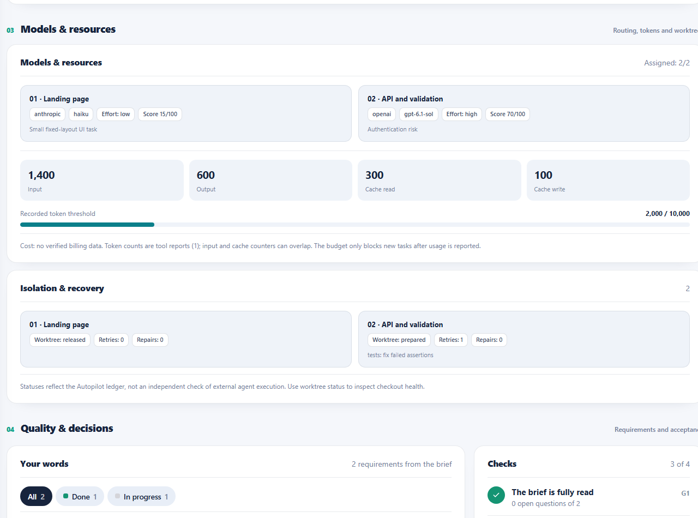

<p align="center">
  <picture>
    <source media="(prefers-color-scheme: dark)" srcset="assets/autopilot-logo-dark.svg">
    <source media="(prefers-color-scheme: light)" srcset="assets/autopilot-logo-light.svg">
    
  </picture>
</p>

<h1 align="center">Autopilot 2.5</h1>

<p align="center"><a href="https://github.com/mrAibo/Autopilot">GitHub: mrAibo/Autopilot</a></p>

<p align="center"><strong>Beschreibe, was gebaut werden soll – und bekomm ein fertiges Projekt.</strong></p>

<p align="center"><a href="README.md">English</a> · <a href="README.ru.md">Русский</a> · <b>Deutsch</b></p>

Autopilot ist ein Entwicklungs-Framework in Form eines Skills. Er nimmt deine Idee, stellt genau dort Fragen, wo sie sich verzweigt, und erledigt den Rest allein: schreibt die Spezifikation, durchdenkt, woran du nicht gedacht hast, zerlegt die Arbeit in Aufgaben und baut das ganze Projekt. Du musst weder die Spezifikation lesen noch Aufgaben einschätzen noch den Code verstehen.

Er funktioniert für sich allein: Du musst nichts weiter installieren.

> **Entwicklungsstand und Übergabe:** [STATUS.md](STATUS.md) hält den gemergten Stand von main, die aktuelle Validierung, ungelöste Blocker und Anweisungen zum Weitermachen fest.

> **Cargo-Testprüfung nach dem Release:** [Vertrauenswürdige Offline-Cargo-Integrationstests](docs/autopilot/trusted-cargo-tests.md) werden auf dem aktuellen Entwicklungsstand `main` für eingeschränkte, eigenständige Rust-Crates ohne Abhängigkeiten unterstützt, mit Test/Manifest/Lock fest an die Basis gebunden, unabhängigem Wiederholungslauf auf dem Host und ohne beliebige Befehle. Das ändert **nicht** den veröffentlichten, rein Python-basierten Tag `v2.3.0` und bedeutet keine Sandbox.

> **Git-Vorabprüfung für bestehende Projekte:** Eine [schreibgeschützte Repository-Diagnose](docs/autopilot/repository-preflight.md) erkennt grundlegende Hindernisse für die Git-Isolation, ohne Dateien zu ändern oder Dateinamen preiszugeben. Das ist projektunabhängige Autopilot-Funktionalität.

> **Routing nur nach Modell (Änderung nach 2.3):** Wenn ein Host das Modell des benannten Agenten wirklich durchsetzen, aber keinen Effort setzen kann, erlaubt `effort_selection:false` Profile ohne Effort-Feld. Der angezeigte Effort ist nur ein Hinweis. Die Prüfungen von Modell, Name und Host bleiben Pflicht; die native Agentenunterstützung der Codex-GUI wird durch diese Änderung **nicht** freigeschaltet. Siehe [Modell-Routing](docs/autopilot/model-routing.md).

> **Automatische Modellwahl bei der Planung:** `ap.py plan-models` wählt Modell und Reasoning Effort **pro Ticket** nach Komplexität und Risiko. `--apply` registriert alle Profile nur bei vom Host unterstützten Fähigkeiten. Siehe [adaptives Routing](docs/autopilot/model-routing.md). Das belegt nicht die tatsächliche Ausführung in der GUI.

> **Sicherer sequenzieller Fallback:** Der [hostverifizierte Ein-Ticket-Modus](docs/autopilot/sequential-host.md) nutzt echte Git-Worktrees und unabhängige Tests, wenn benannte GUI-Subagenten nicht verfügbar sind. Das verifiziert weder das aktuelle GUI-Modell/den Effort noch die Token-Abrechnung. Hat Codex einen noch nicht gestarteten Lauf wegen der Subagenten-Prüfung angehalten, schaltet `py -3.13 .autopilot/ap.py execution sequential-host --no-serve` ihn ohne `init` um. Nötig ist eine verifizierte Git-Basis; die veröffentlichte 2.3.0 akzeptiert Python unittest, spätere Entwicklung brachte einen begrenzten Cargo-Testadapter.

> **Release-Qualifikation:** [R01–R06-Nachweise und der abgegrenzte Support in 2.3.0](docs/autopilot/release-readiness.md) — der sequenzielle Host-Modus von Codex ist veröffentlicht; native benannte GUI-Agenten und Modellerzwingung sind weiterhin nicht verifiziert; das strikte Routing von Claude Code ist in 2.4.0 stabil (Desktop-App und Terminal-CLI).

> **Autopilot 2.3.0 — eingeschränkter Codex-Release.** Unterstützter Ablauf: expliziter [sequenzieller Host-Modus](docs/autopilot/sequential-host.md) mit jeweils einem Git-isolierten Ticket und unabhängiger Verifikation per Python-unittest auf dem Host. **Nicht enthalten:** garantierte native benannte Subagenten der Codex-GUI, erzwungenes GUI-Modell/Effort, verifizierte Abo-Abrechnung oder automatische CLI-/API-Inferenz. Siehe [Release-Umfang](docs/autopilot/release-readiness.md), [STATUS.md](STATUS.md) und [brief.md](brief.md).

> **Autopilot 2.4.0 — Claude Code.** Claude Code mit Abonnement wird im strikten Routing-Modus unterstützt und wurde live in der Desktop-App und in der Terminal-CLI (headless `claude -p`) qualifiziert: siehe [claude-code.md](docs/autopilot/claude-code.md) und die [Qualifikationsergebnisse](docs/autopilot/claude-qualification.md). Bekannte Grenzen:
> - parallele Tickets sind nur mit `--isolated-tickets` (Autopilot-eigene Worktrees) live getestet; in einem gemeinsamen Baum führe sie einzeln aus;
> - nutze `/subtask` und `/fork` nicht während strikter Tickets;
> - ein eigener `ANTHROPIC_BASE_URL`-/`ANTHROPIC_MODEL`-Router ändert, was läuft und was die Attestierung sieht.

<p align="center">
  <a href="assets/dashboard-31-desktop.png"></a>
  <a href="assets/dashboard-31-narrow.png"></a>
</p>

<p align="center"><sub>Dashboard 3.1 · aktuelle 2.3-Vorlage · synthetische Demonstrationsdaten</sub></p>
<p align="center"><a href="assets/dashboard-31-models.png"></a></p>

**Und du siehst jederzeit, was gerade passiert.** Zu Beginn des Baus öffnet der Agent das Dashboard selbst — eine einzelne HTML-Datei, die du weder suchen noch starten musst. Die Farbe der Kopfzeile zeigt den Zustand auf einen Blick: blau — der Bau läuft, orange — er wartet auf deine Antwort, grün — fertig. Darunter: was gerade passiert, wie viel noch übrig ist, jede Aufgabe als farbiger Balken und jede deiner Anforderungen in deinen eigenen Worten. Die Zeitmesser laufen live, die Seite aktualisiert sich selbst, Internet ist nicht nötig.

---

**Bereits laufende Projekte:** Das aktuelle Dashboard 3.1 ist eine kopierte HTML-Datei; es aktualisiert sich in bestehenden Projekten nicht automatisch.
[Aktualisiere es sicher](docs/autopilot/gui-clients.md), ohne Aufgaben zurückzusetzen.

**Was fertig ist:** die ursprünglichen Skill-Stufen, Anforderungs-Gates,
die Modell-Routing-Richtlinie, das Dashboard, die Git-Isolation und vertrauenswürdige Tests.
**Was unverifiziert bleibt:** die native Ausführung benannter Agenten in der
Codex-GUI-Sitzung des Eigentümers und belegte Einsparungen. (Claude Code ist in der Desktop-App
und in der Terminal-CLI qualifiziert; siehe den Hinweis zu 2.4.0 oben.)
Der optionale Codex-CLI-Pfad startet derzeit **keine** kostenpflichtigen Modelle.

Reine Forschungs-API-Piloten und zusätzliche Supervisoren sind **nicht nötig**, um
`/autopilot` zu nutzen. Siehe [Umfang und experimentelle Komponenten](docs/autopilot/scope-and-labs.md), [Testdetails](STATUS.md) und
[Host-Werkzeuge](docs/autopilot/controller.md).

Gemessene Ergebnisse für 2.2 gegenüber 2.3 findest du im [reproduzierbaren Offline-Benchmark R06](docs/autopilot/r06-offline-benchmark.md). Er misst reine Host-Git-/CLI-Prüfungen ohne Modellaufrufe. **Einsparungen bei KI-Tokens zwischen 2.2 und 2.3 sind nicht belegt**; was das Modell der Hauptsitzung und das Ticket-Routing sparen, ist in [measuring-cost.md](docs/autopilot/measuring-cost.md) gemessen.

## Installation

> **Entwickler-verknüpfte Installation:** Auf <HOST> zeigen die globalen Codex- und Claude-Skill-Pfade bereits über verifizierte Windows-Junctions auf diesen Checkout; installiere keine weitere Kopie. Sobald dieser Release gemergt ist, installieren die folgenden Befehle Autopilot 2.3.0 aus dem veröffentlichten Repository. Ersetze die entwicklerverknüpften Junctions nicht durch ein globales `npx skills update -g`.

### Wenn du lieber kein Terminal öffnen willst

Öffne deinen KI-Agenten — Claude Code, Cursor, Codex — und füge das hier ein:

```
Installiere mir den Skill Autopilot. Führe im Terminal aus:

npx skills add mrAibo/Autopilot --skill autopilot -g -y -a <setz dich selbst ein: claude-code, cursor, codex>

Falls npx nicht gefunden wird, gib mir einen Link zum Download von Node.js und warte.
Installiere sonst nichts.
Wenn du fertig bist, sag mir in einer Zeile, dass alles bereit ist und dass die Sitzung neu gestartet werden muss.
```

Den Rest erledigt der Agent. Starte ihn danach neu — Skills werden beim Start geladen.

Dieser Befehl ist für die **erste** Installation. Das spätere Aktualisieren läuft über [einen anderen Befehl](#aktualisieren-und-entfernen).

### Im Terminal

Kopiere diese Zeile:

```bash
npx skills add mrAibo/Autopilot
```

Der Installer fragt, welche Skills für welche Agenten installiert werden sollen — bestätige einfach.

<details>
<summary>Installation in einer Zeile, ohne Rückfragen</summary>

```bash
npx skills add mrAibo/Autopilot --skill autopilot -a claude-code -g -y
```

| Flag | Was es bewirkt |
|------|----------------|
| `--skill autopilot` | Installiert nur Autopilot |
| `-a claude-code` | Installiert für Claude Code |
| `-g` | Global — der Skill steht in jedem Projekt zur Verfügung |
| `-y` | Keine Rückfragen |

Ohne `-g` wird der Skill nur in den aktuellen Projektordner installiert.

</details>

**Voraussetzungen:** [Node.js](https://nodejs.org) (für `npx`) und ein beliebiger unterstützter KI-Agent — Claude Code, Cursor, Codex und [70+ weitere](https://github.com/vercel-labs/skills#supported-agents). Sonst nichts.

---

## So benutzt du es

Öffne deinen Agenten im Ordner des künftigen Projekts und tippe:

```
/autopilot Ich möchte einen Telegram-Bot, der Reparaturanfragen für Haushaltsgeräte annimmt
und in eine Google-Tabelle schreibt
```

Autopilot startet **nur mit diesem Befehl**. Von selbst startet er nie, auch nicht, wenn du „bau es einfach“ schreibst: Er legt ein Repository an, schreibt Code und committet, und das soll nur auf dein Wort hin beginnen.

### In Claude Code: zwei Durchgänge — Plan, dann Bau

Ein Projekt (neu oder bestehend) braucht **zwei Chats** im selben Ordner:

1. **Plan.** Öffne einen Chat im Projektordner. Wähle das Modell: **Sonnet** für normale Aufgaben, **Opus** nur, wenn die Idee groß oder noch unscharf ist. Tippe `/autopilot` mit deiner Idee oder einer Datei (`/autopilot brief.md`). Beantworte die Fragen. Autopilot schreibt die Spezifikation und die Aufgabenliste, registriert die Bau-Agenten und **hält an** mit: *„Die Bau-Agenten sind registriert … öffne einen neuen Chat in diesem Ordner und tippe `/autopilot`“*.
2. **Bau.** Öffne einen **neuen** Chat im selben Ordner, wähle **Sonnet**, tippe nur `/autopilot`. Er übernimmt den Plan und baut das Projekt bis zum Ende: wieder ohne Fragen, das Dashboard zeigt den Fortschritt, am Ende kommt ein Bericht.

Warum zwei Chats: Claude Code sieht nur Agenten, die beim Start des Chats schon existierten, deshalb kann der Bau nicht im Planungs-Chat laufen. Und ein frischer Chat mit Sonnet ist der günstigere Weg zu bauen (in unserer Messung etwa die Hälfte der Kosten gegenüber dem ganzen Lauf auf Opus).

Terminal: `claude --model opus` (oder `sonnet`) → `/autopilot …`; danach ein neues `claude --model sonnet` → `/autopilot`. Bricht ein Chat an irgendeiner Stelle ab, öffne einen neuen im Ordner und tippe `/autopilot` — der Lauf geht dort weiter, wo er stehen geblieben ist. **Codex** arbeitet wie bisher in einem Durchgang.

**Wenn die Aufgabe groß ist, leg sie in eine Datei.** Eine ausführliche Beschreibung passt nicht in eine Chatzeile, und du solltest sie nicht kürzen: Je mehr du erzählst, desto weniger muss für dich geraten werden. Lege neben dem Projekt eine Datei an — beliebiger Name, `brief.md`, `idea.txt`, `task.md` — und beschreibe darin alles frei: was das Projekt ist, für wen, was es können muss, was dir an der Konkurrenz nicht gefällt, welche Budget- und Terminvorgaben es gibt. Dann verweise einfach darauf:

```
/autopilot brief.md
```

```
/autopilot deep docs/idea.md aber ohne Kartenzahlung
```

Der Agent liest die Datei und übernimmt ihren Inhalt als Aufgabe; deine Datei bleibt unberührt, und eine Kopie landet in `.autopilot/` — gegen genau diese Kopie wird das Ergebnis am Ende geprüft. Wörter, die hinter dem Pfad stehen, gehören zur selben Aufgabe.

Danach beantwortest du nur noch ein paar Fragen ganz am Anfang.

Die erste Antwort des Agenten sagt dir, in welchem Modus er arbeitet und welche anderen es gibt, und **er öffnet das Dashboard selbst** — keine Befehle zum Merken, keine Dateien zum Suchen:

```
Modus: Halbautomatik · Tiefe: normal — ich frage nur, was die Aufgabe offenlässt, den Rest baue ich selbst.
Dashboard ist offen und aktualisiert sich selbst: http://localhost:52814/dashboard.html
Projektgedächtnis — AGENTS.md (+ CLAUDE.md, das darauf verweist).

Du kannst jederzeit wechseln, sag einfach:
• „vollautomatisch“ — ich frage gar nichts
• „interviewe mich“ — ich gehe die Aufgabe mit Fragen bis zum Ende durch, dann baue ich selbst
• „jeden Schritt freigeben“ — dasselbe, und du gibst zusätzlich Spezifikation und Aufgabenliste frei
• „genau wie geschrieben“ / „geh in die Tiefe“ — weniger oder mehr Ausarbeitung über das Gesagte hinaus
```

Fragen kommen in **Runden**: mehrere auf einmal, nummeriert, jeweils mit der Antwort, die der Agent selbst wählen würde. Bist du mit allen einverstanden — antworte „ok“; bei einer nicht — „2 — eine Tabelle, der Rest ok“.

---

## Ein vorhandenes Projekt weiterentwickeln

**Autopilot ist nicht auf neue Repositories beschränkt.** Öffne Codex, Claude Code oder
einen anderen Skill-fähigen Agenten **im Wurzelverzeichnis deines bestehenden Projekts**, nicht
im Quellrepository von Autopilot. Stelle sicher, dass der Skill installiert ist, und starte
eine neue Aufgabe, die beschreibt, was sich ändern soll:

```text
/autopilot Erweitere diese bestehende Anwendung um einen CSV-Export.
Erhalte die aktuelle API, die Datenbank, die Tests und die Nutzerdaten.
```

Oder schreibe deinen Wunsch in eine Datei im Projekt und rufe `/autopilot brief.md` auf.
Der Agent untersucht zuerst das Repository, seinen Git-Verlauf und Worktree,
`AGENTS.md` / `CLAUDE.md`, den aktuellen Stack, die Tests und festgehaltene Entscheidungen.
Er **nutzt den vorhandenen Code weiter**, schreibt Anforderungen für die *neue Änderung*
und plant nur die fehlende Arbeit. Deine nicht committeten Änderungen löscht, überschreibt, stasht
oder resettet er nicht und committet sie auch nicht. Vor
destruktiven Aktionen oder Änderungen außerhalb des vereinbarten Umfangs muss er fragen.

Gibt es im Projekt schon einen Ordner `.autopilot/`, prüft der Agent
`.autopilot/state.js`, **bevor** er entscheidet, ob ein neuer Lauf beginnt.
Ein abgeschlossener Lauf bleibt in der Historie; eine neue Funktion kann einen neuen Lauf starten.
Um **denselben abgeschlossenen Lauf** zu erweitern, statt einen eigenen anzulegen,
gibt es im Skill den dokumentierten Weg `reopen`. In keinem der beiden Fälle muss
das Projekt von Grund auf neu gebaut werden.

> **Ein vorhandenes Projekt prüfen.** `/autopilot Audit` (oder `/autopilot Audit: Sicherheit und Performance`) liest das Projekt und schreibt einen Bericht nach `.autopilot/audits/<Datum>-audit.md` – sonst ändert es nichts: keine Änderungen, keine Commits, keine Installationen, kein Netzwerk. Günstige Explorer prüfen parallel je einen Bereich (Korrektheit, Sicherheit, Performance, Tests, toter Code, Doku, Abhängigkeiten), und ein stärkerer Prüfer behält nur, was er im Code mit einem konkreten Fehlerszenario bestätigt. Jeder Befund hat eine ID (`A01`…) und ein Kästchen. Hake an, was behoben werden soll, und starte `/autopilot .autopilot/audits/<Datei>.md` – der Build übernimmt nur die angehakten Punkte. Details: [docs/autopilot/audit.md](docs/autopilot/audit.md).

## Fortsetzen, wenn ein Agent oder Chat unterbrochen wurde

**Nichts startet sich im Hintergrund von selbst neu.** Öffne nach einem Absturz, Kontextlimit,
geschlossenem Terminal oder verlorenem Chat **dasselbe Projektverzeichnis** in einer
neuen Agentensitzung und gib ein:

```text
/autopilot
```

Der Projektagent — nicht du — folgt dann
[`phases/0-resume.md`](skills/autopilot/phases/0-resume.md):

1. Den unfertigen Lauf anhand von `.autopilot/state.js` identifizieren; das Gedächtnis des Projekts
   (`AGENTS.md` / `CLAUDE.md`), sein Manifest, datierte
   `*-brief.md`-Dateien, Schnittstellen, Tickets und die aktuelle Phase lesen. Die Datei
   `.autopilot/PROGRESS.md` als zusätzlichen Kontext lesen, nicht als Ersatz
   für den aktuellen Zustand. **`init` nicht erneut starten.**
2. `git status --short --branch` und `python3 .autopilot/ap.py commits` ausführen. Prüfen, dass
   erledigte Aufgaben ihre tatsächlichen Commits noch haben. Unterbrochene
   Aufgaben und ihre ausstehenden Worktrees/Diffs untersuchen, bevor der Status einer Aufgabe zurückgesetzt wird.
   Unfertigen Code nicht verwerfen, nicht blind übernehmen und nicht automatisch committen.
3. Das lokale Dashboard wiederherstellen und die aktuelle Phase, die nächste Aufgabe und
   jede offene Frage anzeigen. Die etablierten Prüfungen des Projekts erneut ausführen, bevor
   es weitergeht; bereits akzeptierte Aufgaben oder schon beantwortete
   Fragen **nicht** wiederholen. Wurde eine Entscheidung nie gespeichert, nur nach dieser fragen.
4. Vom letzten **verifizierten** Punkt aus fortsetzen. Die verborgenen
   Gedanken des vorigen Chats oder ein Modell-Werkzeugaufruf, der nie dauerhafte Dateien erzeugt hat, **lassen sich
   nicht wiederherstellen**; als Beleg zählen nur committeter Code und gespeicherter Zustand.

Besitzt bereits eine andere laufende Sitzung den Lauf, muss der Agent **anhalten, statt
zwei Schreiber** auf denselben `state.js` loszulassen. Lösche nicht
`.autopilot/`, bearbeite `state.js` nicht von Hand und führe kein `git reset --hard` aus,
um eine Fortsetzung zu „reparieren“. Ein Agent, der auf die Projektdateien nicht zugreifen kann, muss das sagen,
statt so zu tun, als hätte er weitergemacht.

Das ist die **Fortsetzung eines unfertigen Laufs**; für *neue Arbeit nach einem abgeschlossenen
Lauf* gilt der vorige Abschnitt. Lies die ausführliche
[Entscheidungstabelle der Vorabprüfung](skills/autopilot/phases/0-preflight.md)
und die [Worktree-Wiederherstellungsregeln](docs/autopilot/worktrees.md).

---

## Vier Modi

Nach `/autopilot` kannst du ergänzen, wie eng du beteiligt sein willst. Ergänzt du nichts, bekommst du **Halbautomatik**.

| Modus | Wie du ihn einschaltest | Was du gefragt wirst |
|---|---|---|
| **Vollautomatisch** | `/autopilot full ...` oder „vollautomatisch“ | Nichts. Am Ende — eine Liste der Entscheidungen, die für dich getroffen wurden |
| **Halbautomatik** *(Standard)* | nichts zu ergänzen | Nur, was die Aufgabe offenlässt: meist eine oder zwei Fragerunden. Ist alles klar — keine |
| **Interview** | `/autopilot interview ...`, „interviewe mich“, „frag mich alles“ | Jede Verzweigung, dazu die Stellen, an denen die Idee scheitern könnte. Dann baut er allein |
| **Manuell** | `/autopilot manual ...` oder „jeden Schritt freigeben“ | Wie Interview, danach dein „ok“ zur Spezifikation und zur Aufgabenliste |

```
/autopilot full eine Landingpage für einen Pizza-Lieferdienst

/autopilot Ein Telegram-Bot zur Buchung von Maniküre-Terminen

/autopilot manual CRM für eine Autowerkstatt, ich möchte die Spezifikation selbst freigeben
```

Die Wörter `full`, `semi`, `interview`, `manual` schreibst du ohne Bindestriche. Den Modus kannst du unterwegs ändern — „wechsle auf manuell“ — er gilt ab der nächsten Stufe.

**Was kein Modus ändert:** Der Agent fragt vor allem, was sich nicht rückgängig machen lässt — Veröffentlichung, Zahlungen, Nachrichten an Personen, Löschen von Daten. Und kein Modus schaltet den Abgleich mit deiner ursprünglichen Aufgabe ab.

---

## Tiefe

Ein eigener Regler, unabhängig vom Modus. Der Modus bestimmt, **wie viel du gefragt wirst**; die Tiefe bestimmt, **wie viel für dich durchdacht wird**.

| Tiefe | Wie du sie einschaltest | Was der Agent tut |
|---|---|---|
| **Strict** | `/autopilot strict ...` oder „genau wie geschrieben“ | Nur, was du geschrieben hast. Keine eigenen Funktionen — auch keine guten. Fehler und leere Zustände werden trotzdem behandelt: Ohne sie funktioniert eine Anforderung schlicht nicht |
| **Normal** *(Standard)* | nichts zu ergänzen | Arbeitet die Lücken durch, die das Ergebnis offensichtlich verderben würden. Er darf Eigenes ergänzen, aber jeweils an eine deiner Anforderungen gebunden |
| **Maximum** | `/autopilot deep ...` oder „geh in die Tiefe“, „denk es durch“ | Jede Anforderung durchläuft die volle Checkliste: erster Start, leerer Bildschirm, falsche Eingabe, Fehlschlag, abgebrochene Verbindung, Wachstum, Berechtigungen, Folgen |

```
/autopilot strict ein Feedback-Formular, genau wie beschrieben

/autopilot deep ein Online-Shop für Keramik

/autopilot full deep ein Marktplatz für Handwerker
```

Die Reihenfolge der Wörter ist egal, beide Einstellungen sind optional. Wie den Modus kannst du auch die Tiefe unterwegs ändern: „weniger Eigenes“ oder „denk mehr durch“.

**Eine Regel gilt in jeder Tiefe:** Alles, was der Agent von sich aus hinzufügt, ist an eine deiner Anforderungen gebunden und steht im Abschlussbericht gesondert aufgelistet. Eine Funktion, die an nichts gebunden ist, wird gestrichen.

---

## Referenz — wie das Ergebnis aussehen soll

Gibt es Websites, Apps oder Texte, denen das Ergebnis ähneln soll, sag es, wenn der Agent im Briefing danach fragt. Sie landen in `reference.md` und gehen an die Agenten, die das bauen, was du später siehst: Die Oberfläche wird von Anfang an „so wie dort“ gemacht, nicht erst nachträglich angepasst. Der Agent gibt seinen eigenen Geschmack nie als deinen aus — eine Referenz kommt immer nur von dir.

---

## Zwei Dinge, die Autopilot anders macht

### Deine Aufgabe geht unterwegs nicht verloren

Das übliche Problem beim Bauen „nach Beschreibung“: Du diktierst ein großes Briefing, dann kommen Fragen, eine Spezifikation, Aufgaben, Code — und am Ende fehlt die Hälfte dessen, was du verlangt hast. Nicht, weil sich jemand geweigert hätte, sondern weil es an irgendeinem Schritt nicht mehr erwähnt wurde.

Autopilots erster Schritt ist, deinen Text in **nummerierte Anforderungen** zu zerlegen und sie wortwörtlich festzuhalten. Ab dann hat jede Anforderung einen Status, und jede Stufe hat eine Prüfung:

- nach der Spezifikation — keine Anforderung bleibt ohne Abschnitt;
- nach der Aufteilung — jede Anforderung hat eine Aufgabe, **und jede Aufgabe hat eine Anforderung** (das fängt Arbeit ab, die niemand bestellt hat);
- am Ende — die **Blindabnahme**: Ein separater Agent bekommt nur deinen Originaltext und das fertige Projekt, nicht die Spezifikation. Er prüft das Ergebnis gegen deine Worte, nicht gegen eine Nacherzählung. Weichen er und der Tracker voneinander ab, siehst du das im Bericht.

**Nur du kannst eine Anforderung fallen lassen.** Der Agent darf vorschlagen, eine zu verschieben — streichen darf er sie nicht. Schweigen gilt nicht als Absage.

### Woran du nicht gedacht hast, wird für dich durchdacht

In einem Briefing beschreibst du, wie alles funktioniert, wenn alles gut geht. Du beschreibst nicht, was auf einem leeren Bildschirm erscheinen soll, was passiert, wenn die Verbindung abbricht, was geschieht, wenn jemand zweimal auf „Senden“ drückt, oder was ein Mensch beim allerersten Start sieht. Das ist kein Versäumnis — auf dieser Ebene beschreibt man eine Aufgabe einfach nicht.

Das Durchdenken ist ein großer Teil von Autopilots Wert, und wie viel davon passiert, legst du mit der [Tiefe](#tiefe) fest. Bei normaler Tiefe schließt der Agent die Lücken, die das Ergebnis offensichtlich verderben würden; bei maximaler Tiefe schickt er jede Anforderung durch die volle Checkliste. Manches entscheidet er selbst (eine Fehlermeldung, sinnvolle Grenzen); wo die Entscheidung wirklich bei dir liegt, macht er daraus eine Frage.

Bei maximaler Tiefe entfaltet sich eine Anforderung aus dem Briefing zu mehreren ausgearbeiteten Szenarien — so vielen, wie sie wirklich Seiten hat. Das ist der Unterschied zwischen „läuft in der Demo“ und „läuft“.

---

## Der Fortschritt ist immer sichtbar

`.autopilot/dashboard.html` **öffnet sich von selbst** ganz zu Beginn des Baus — nichts zu suchen oder zu starten. Kann der Agent eine Seite in seinem eigenen Fenster anzeigen (zum Beispiel im Seitenbereich der Claude-App), öffnet sich das Dashboard dort und alles bleibt in einem Fenster; sonst in deinem Browser. In einem schmalen Bereich neben dem Chat wird es dichter: dieselben Blöcke, nur ohne die riesigen Zahlen. Funktioniert offline. Solange der Bau läuft, holt sich die Seite alle zehn Sekunden frische Zahlen — ohne Neuladen, sodass deine Scrollposition und markierter Text erhalten bleiben; der Pfeil ⟳ oben aktualisiert sofort. Daneben sind die Schalter für Design (hell / dunkel) und Sprache (RU / EN); solange du das Design nicht anfasst, folgt das Dashboard deinem System.

**Die Kopfzeile — was passiert, in einem Satz.** Blau: Der Bau läuft — „2 von 6 Tickets fertig, 3 weitere in Arbeit“, welche Tickets geschrieben werden, welche im Review sind und wie lange es bis zum Ende dauert, einschließlich Review und Abnahme. Orange: **Der Bau wartet auf dich** — Briefing-Fragen, dein „ok“ zur Spezifikation im manuellen Modus, eine Entscheidung vor einem unumkehrbaren Schritt; der Browser-Tab zeigt „● Wartet auf dich“, und die Bauuhr steht in der Zwischenzeit still. Grün: fertig — was du jetzt hast und was du tun musst, um es wirklich laufen zu lassen. Unter dem Satz — acht Stufen von der Vorbereitung bis zur Abnahme: bestanden, aktuell, übersprungen.

**Bau-Fortschritt — jeder Zustand hat seine eigene Farbe.** Grün — Aufgabe fertig, orange gestreift — wird geschrieben, türkis — im Review, lila — vom Review zur Nachbesserung zurückgekommen, rot — fehlgeschlagen, gestrichelt — wartet, bis sie dran ist. Unter einem Nachbesserungs- oder Review-Balken steht, warum. Aufgaben sind in Wellen gruppiert: Du siehst, was parallel läuft und worauf die nächste Welle wartet.

**Deine Worte.** Jede Anforderung aus dem Briefing — als dein Zitat, mit dem, was daraus wurde: erledigt, in Arbeit, braucht deine Daten, verschoben, von dir gestrichen. Bei Verschobenem und Platzhaltern steht der Grund. Das ist Autopilots wichtigstes Versprechen — nichts verschwindet stillschweigend — und hier kannst du es mit eigenen Augen prüfen.


| Block | Was er zeigt |
|---|---|
| **Anforderungen** | Wie viele deiner Anforderungen abgeschlossen sind. Aufgaben können zu 100 % fertig sein, während das Briefing bei 70 % steht |
| **Prüfungen G1–G4** | Das Briefing ist vollständig gelesen · die Spezifikation hat nichts verloren · jede Anforderung steckt in einer Aufgabe · Blindabnahme. Eine Prüfung bekommt ihr Häkchen, wenn sie besteht |
| **Feed** | Die letzten Ereignisse in Worten: Aufgabe fertig, ins Review geschickt, zur Nachbesserung zurück, der Plan geht auf. Die beste Antwort auf „lebt es noch?“ |
| **Von dir benötigt** | Schlüssel für `.env`, Platzhalter, die für deine Daten stehen, für dich getroffene Entscheidungen |
| **Tests und Zeit** | Wie viele Tests grün sind; Arbeitszeit ohne Leerlauf und ohne das Warten auf deine Antwort |
| **Im Bericht** | Blindabnahme und ihre Abweichungen, offene Fragen, Review-Anmerkungen mit ihrer Stelle im Code |

Auch wenn das Projekt klein ist und als einzelne Aufgabe gebaut wird, füllt sich das Dashboard genauso: Stufen, Anforderungen, Tests, Commit und Platzhalter. Reißt die Sitzung ab, tippe `/autopilot` ohne weitere Worte — der Agent stellt den Zustand aus den Dateien wieder her und macht dort weiter, wo er aufgehört hat.

---

## Das Projekt erinnert sich selbst

Der übliche Ärger in der zweiten Sitzung: Der Agent öffnet ein fertiges Projekt und braucht eine halbe Stunde, um herauszufinden, was hier überhaupt gebaut wurde — auf dein Geld. Autopilot behebt das mit einer Projektbeschreibung im Wurzelverzeichnis — `AGENTS.md`.

Die Datei entsteht **sofort**, noch vor der ersten Codezeile: der Name, die Startbefehle. Danach kommt nur hinein, was unterwegs wirklich herausgefunden wurde — der echte Prüfbefehl, Stolperfallen, in die schon jemand getreten ist, eine neue Umgebungsvariable. Ganz am Ende liest ein separater Agent den **fertigen Code** (nicht die Spezifikation — sonst würde die Beschreibung von Plänen erzählen) und schreibt Wegweiser: wie man es startet, wo was liegt, wo es wehtut. Bei einem großen Projekt wandert die Architektur nach `docs/architecture.md` und Entscheidungen samt Gründen nach `docs/adr/`.

| | |
|---|---|
| Welche Datei | `AGENTS.md` — gelesen von Claude Code, Codex, Cursor und anderen Agenten. Daneben liegt eine `CLAUDE.md` mit der einen Zeile `@AGENTS.md`: Ohne sie überspringt Claude Code `AGENTS.md`, wenn irgendwo weiter oben im Ordnerbaum eine andere `CLAUDE.md` liegt |
| Du hast schon eine eigene `CLAUDE.md` oder `AGENTS.md` | Autopilot **fasst sie nicht an**. Am Ende schlägt er vor, was ergänzt werden könnte — neue Befehle, Variablen, Stolperfallen — und fragt, ob er es anwenden soll. Im vollautomatischen Modus bleibt der Vorschlag einfach als Datei liegen |
| Umfang | Proportional zum Projekt und kurz: Jede Zeile dieser Datei wird in jeder künftigen Sitzung gelesen |
| Dein Text | Alles, was du geschrieben hast, ist unantastbar. Autopilot schreibt nur innerhalb seiner eigenen Markierungen |

---

## So funktioniert es

Das Hauptprinzip: **Die Reihenfolge ist das Produkt**. Code wird in der vorletzten Phase geschrieben; alles davor klärt, was genau gebaut werden soll, alles danach beweist, dass genau das gebaut wurde.

| Phase | Was passiert |
|---|---|
| **Vorabprüfung** | Einrichtung des Projektordners, `.gitignore`, Instrumente — das Dashboard öffnet sich sofort |
| **Anforderungen** | Dein Text → nummerierte Anforderungen, wortwörtlich |
| **Briefing** | Fragen in Runden, nur bei echten Verzweigungen; zuerst die, ohne die das Projekt nicht gebaut werden kann: Zahlungen, Hosting, Zugänge |
| **Spezifikation** | Anforderungen entfalten sich zu ausgearbeiteten Szenarien |
| **Plan** | Die Spezifikation wird in Aufgaben zerlegt — oder nicht, wenn die Arbeit klein ist — und in Wellen angeordnet: was gleichzeitig gebaut werden kann und was nur der Reihe nach |
| **Entwicklung** | Eine Aufgabe = ein eigener Agent mit sauberem Gedächtnis, ein Commit; unabhängige Aufgaben laufen parallel |
| **Code-Review** | Am Ende, immer — der gesamte Bau: Übereinstimmung mit Briefing und Spezifikation, Codequalität, Sicherheit. Früher und einzeln — nur die erste Aufgabe, auf der die übrigen aufbauen, und Aufgaben zu Anmeldung, Schlüsseln, Geld und Löschen von Daten; diese Prüfung läuft nebenher und hält den Bau nie auf |
| **Abnahme** | Ein separater Agent installiert das Projekt von Grund auf in einer sauberen Kopie, startet es und prüft das Ergebnis gegen deine ursprüngliche Aufgabe; die Projektbeschreibung für die Zukunft; der Bericht |

### Zur Aufteilung in Aufgaben

Jede Aufgabe ist ein eigener Agent, der sich von null in das Projekt einarbeiten muss: Verträge lesen, Code studieren, den Stack klären. Das ist teuer. Deshalb teilt Autopilot nach Codeumfang auf, nicht nach „je kleiner, desto sicherer“: Ein Agent schreibt etwa 3.000 Zeilen, Tests eingeschlossen.

| Umfang | Wie viele Aufgaben |
|---|---|
| Bis ca. 3.000 Zeilen — eine Landingpage, ein Formular, ein Skript, eine Änderungsliste für ein bestehendes Projekt | **eine.** Ein Agent baut alles in einem Durchgang, wie in einem normalen Dialog |
| ca. 3.000–6.000 | 2 |
| ca. 6.000–18.000 | 3–6, eine pro ca. 3.000 Zeilen |
| ca. 18.000–36.000 | 7–12 |

Mehr als 12 sind nicht erlaubt: Die Arbeit wird auf zwei Läufe verteilt. Feinteilige Aufteilung kauft keine Zuverlässigkeit, sie kauft Kosten.

Auch am anderen Ende gibt es eine Grenze. Bei jedem Schritt liest ein Agent seinen gesamten Kontext neu aus dem Cache, eine Aufgabe wird pro Schritt also teurer, je länger sie läuft. Etwa 3.000 Zeilen entsprechen grob 300–400.000 Token Kontext: Darüber ist ein frischer Agent günstiger als ein langer.

### Zur Entwicklung

| Was Autopilot tut | Warum |
|---|---|
| Jede Aufgabe erledigt ein eigener Agent | Er verheddert sich nicht im angesammelten Kontext und zerstört nicht, was funktionierte |
| Gibt dem nächsten Agenten die Verträge früherer Aufgaben mit | Sonst erfindet Aufgabe sechs neu, was Aufgabe drei gebaut hat |
| Unabhängige Aufgaben laufen parallel, mehrere Agenten gleichzeitig | Auf Unabhängiges der Reihe nach zu warten, sind verschenkte Stunden |
| Ein Commit pro Aufgabe | Deine Rücksetzpunkte |
| Aufgaben mit gemeinsamen Dateien laufen nacheinander | Sonst überschreiben sich zwei Agenten gegenseitig |
| Nach jeder Aufgabe eine vollständige Prüfung — Tests, Typen, Linter | Eine Regression kostet eine Minute, nicht einen Abend |
| Routineaufgaben gehen an ein günstigeres Modell, das Fundament und Riskantes an ein starkes | Du zahlst das starke Modell dort, wo es einen Unterschied macht |
| Review am Ende; eigenständig nur das Fundament und eine enge Liste von Risiken — parallel, ohne den Bau zu stoppen, und höchstens eine Nachprüfung | Das Review fraß früher bis zur Hälfte der Kosten, und eine Prüfung nach jeder Aufgabe hielt den Bau 15–40 Minuten auf; die Fehler, die man früher abfangen sollte, stecken im Fundament und im Code für Anmeldung, Schlüssel, Geld und Löschen |
| Korrekturen nach dem Review macht derselbe Agent, der den Code geschrieben hat | Er weiß noch, warum der Code so ist; ein anderer behebt das Symptom und zerstört die Ursache |
| Die Hauptunterhaltung schreibt überhaupt keinen Code — sie verteilt und prüft nur | Ihr Kontext ist ein einziger für den ganzen Lauf und wird nie erneuert: Jeder bei Aufgabe zwei gelesene Diff stört bei Aufgabe acht |
| Eine gescheiterte Aufgabe — ein Wiederholungsversuch, dann ein Versuch auf anderem Weg | Scheitert auch der, hält der Agent an und erklärt es in einfachen Worten |
| Ein Plan, der vom Code abgewichen ist, wird laut korrigiert | Zeigt sich unterwegs, dass der Plan nicht trägt, korrigiert der Agent den Plan und sagt es dir in einer Zeile — statt still etwas anderes zu bauen |

### Sparsamer arbeiten

- **Modell der Hauptsitzung.** Für normale Arbeit starte `/autopilot` einfach mit Sonnet. Opus lohnt sich nur bei einer komplexen oder unscharfen Idee, und dann in drei Schritten: (1) starte `/autopilot` mit Opus und lass Briefing, Spezifikation und Plan durchlaufen; (2) wenn der Plan steht, öffne einen **neuen Chat im selben Ordner** mit Sonnet (Desktop-App: Modellauswahl; CLI: `claude --model sonnet` oder `/model sonnet` vor der Eingabe); (3) tippe dort `/autopilot` — der Lauf setzt anhand der Dateien in `.autopilot/` beim Bau fort, und der neue Chat beginnt mit kleinem Kontext. Lass den alten Chat ungenutzt. Autopilot schlägt das am Ende der Planphase selbst vor. In einem strikten Claude-Code-Lauf ist der neue Chat **Pflicht**, auch mit Sonnet: Die Bau-Agenten, die Autopilot am Ende des Plans registriert, sieht Claude Code erst in einer neuen Sitzung, deshalb hält der Plan-Chat dort an. Die Hauptunterhaltung lebt den ganzen Lauf und liest bei jedem Schritt ihren wachsenden Kontext neu, deshalb ist sie der größte Kostenfaktor. In einem kleinen gemessenen Lauf (3 Tickets, Claude-Desktop-App, OpenTelemetry-Schätzung) lag die Hauptsitzung auf Opus bei etwa 1,40 USD und alle drei Subagenten zusammen bei etwa 0,054 USD, rund 96 % der Schätzung; ein zweiter Lauf (2 Tickets, Terminal-CLI, Opus) kam auf etwa 1,20 USD. Das sind `cost.usage`-Schätzungen, keine Abo-Abbuchungen, aus zwei kleinen Läufen; bei größeren Projekten verschiebt sich der Anteil zu den Subagenten. Ein A/B-Vergleich desselben 3-Ticket-Laufs mit der Hauptsitzung auf **Sonnet** kam auf etwa 0,68 USD statt etwa 1,45 USD auf Opus — rund 53 % weniger. Details: [measuring-cost.md](docs/autopilot/measuring-cost.md).
- **Budget.** `python3 .autopilot/ap.py budget --tokens N` verhindert den Start neuer Tickets, sobald die bekannten Eingabe- und Ausgabe-Tokens N erreichen.
- **Messen.** `python3 skills/autopilot/tools/measure-run.py <Projektordner>` liest die Claude-Code-Logs; auch das Dashboard zeigt den Token-Verbrauch.
- **Aufgaben groß lassen.** Verlange kein Review nach jeder Aufgabe und vermeide parallele Läufe in einem gemeinsamen Baum: Sie kosten mehr, als sie sparen.
- Das Modell-Routing gilt nur für Subagenten, nicht für das Modell, das du für die Hauptsitzung gewählt hast.

---

---

## Wann es passt und wann nicht

**Eine gute Wahl, wenn:**

- du beschreibst, was du brauchst, und ein fertiges Ergebnis erwartest;
- du kein Programmierer bist und keine Spezifikationen und keinen Code lesen wirst;
- „bau es einfach“, „bau es von Anfang bis Ende“, „stell keine unnötigen Fragen“;
- du Spezifikation und Aufgabenliste freigeben, dich aber nicht um den Prozess kümmern willst — das ist der manuelle Modus.

**Nicht geeignet, wenn:**

| Situation | Was du stattdessen tun kannst |
|---|---|
| Du willst gemeinsam Code schreiben, Zeile für Zeile | Arbeite direkt mit dem Agenten |
| Die Aufgabe ist eine Änderung in einer Datei | Bitte einfach darum |
| Die Idee ist größer als ein Projekt und das Endziel ist unklar | Kläre zuerst das Ziel |

---

## Schlüssel, Passwörter und Zugänge

Autopilot **fragt nie nach Schlüsseln, Tokens oder Passwörtern** — nur danach, welchen Dienst du nutzen willst und ob du dort ein Konto hast.

- die Frage lautet „nehmen wir Zahlungen über Stripe oder PayPal?“, nicht „schick mir den Schlüssel“;
- der Code bekommt einen Variablennamen — `STRIPE_SECRET_KEY`, und den Wert trägst du selbst in `.env` ein;
- `.env` kommt sofort in `.gitignore`;
- der Bericht listet die noch auszufüllenden Variablen auf, mit Namen und ohne Werte.

Schickst du doch einen Schlüssel in den Chat, landet er in **keiner Datei**: Bevor irgendetwas geschrieben wird, läuft dein gesamter Text durch einen Filter, der Schlüssel von Stripe, GitHub, AWS, Google und Slack, Telegram-Tokens, JWTs und Verbindungszeichenfolgen erkennt. In die Datei kommt `[REDACTED:STRIPE_SECRET_KEY]` statt des Werts, und du bekommst eine Warnung — ein Schlüssel, der in einem Chat war, sollte widerrufen und neu ausgestellt werden.

---

## Was Autopilot nie tut

- schreibt Code, bevor es eine Spezifikation gibt;
- streicht deine Anforderungen — das kannst nur du;
- erfindet Fakten über dich: Preise, Texte und Adressen bleiben sichtbare Platzhalter, keine glaubhaften Lügen;
- bittet dich, Aufgaben, ihre Größe oder den Code zu prüfen;
- führt zwei Aufgaben im Gedächtnis eines Agenten aus;
- hebt sich Zahlungen, Zugänge und Hosting für den Schluss auf;
- fragt nach deinen Schlüsseln und Passwörtern oder speichert sie;
- installiert oder lädt nichts ohne dein Wissen.

---

## Aktualisieren und entfernen

**Nur `update` aktualisiert.** Installiere den Skill nicht mit dem Befehl aus „Installation“ neu — der ist für die erste Installation; fürs Aktualisieren gibt es einen eigenen Befehl:

```bash
npx skills update autopilot -g
```

Das Flag `-g` gilt für eine globale Installation. Bei einer Projektinstallation führe den Befehl ohne Flag im Ordner dieses Projekts aus.

Wenn du lieber kein Terminal öffnen willst, füge das deinem Agenten ein:

```
Aktualisiere den Skill Autopilot auf die neueste Version. Führe im Terminal aus:

npx skills update autopilot -g

Wenn dort steht, dass alles aktuell ist, die Version aber trotzdem alt bleibt, installiere neu:
npx skills remove autopilot -g -y && npx skills add mrAibo/Autopilot --skill autopilot -g -y -a <setz dich selbst ein: claude-code, cursor, codex>

Wenn du fertig bist, sag mir in einer Zeile, was aktualisiert wurde, und erinnere mich daran, die Sitzung neu zu starten.
```

Anzeigen, was installiert ist, und entfernen:

```bash
npx skills list
```

```bash
npx skills remove autopilot -g
```

**Wenn der Skill sich wie eine alte Version verhält.** `update` vergleicht die Version der Quelle, nicht die Dateien auf der Festplatte: Wurde die lokale Kopie bearbeitet oder ist sie beschädigt, meldet er „alles aktuell“ und tut nichts. Abhilfe schafft eine Neuinstallation:

```bash
npx skills remove autopilot -g -y && npx skills add mrAibo/Autopilot --skill autopilot -g -y -a claude-code
```

Damit der Agent die neue Version sieht, **starte die Sitzung neu** — Skills werden beim Start geladen.

### Woran du erkennst, dass eine neue Version erschienen ist

Zu Beginn jedes Baus vergleicht Autopilot seine Version mit diesem Repository und teilt dir, falls eine neue erschienen ist, in einer Zeile mit, mit welchem Befehl du aktualisierst. Was sich geändert hat, steht in [CHANGELOG.md](CHANGELOG.md). Mitten im Bau aktualisiert sich der Skill nie.

Die Prüfung ist eine einzige Anfrage an GitHub pro Bau und sendet überhaupt keine Daten; ohne Internet bleibt sie stumm. Zum Abschalten: die Umgebungsvariable `AUTOPILOT_NO_UPDATE_CHECK=1`.

---

## Was im Repository liegt

```
skills/autopilot/
├── SKILL.md                    ← Orchestrator: Reihenfolge der Phasen, Gates, Regeln, die nie gebrochen werden
├── phases/                    ← Phasenregeln, jeweils eine gelesen, wenn die Phase beginnt
│   ├── 0-modes.md              Modi und Tiefe, die Eröffnungsnachricht
│   ├── 0-preflight.md          Einrichtung des Repositorys
│   ├── 0-resume.md             Fortsetzen eines unterbrochenen Baus
│   ├── 0-instruments.md        Dashboard: Start und ein Befehl pro Ereignis
│   ├── 0-memory.md             Auswahl der Projektgedächtnis-Datei
│   ├── 1-manifest.md           Briefing → Anforderungen, Filter für Geheimnisse
│   ├── 2-briefing.md           Fragen in Runden, Referenz
│   ├── 2-adversarial.md        wo die Idee scheitern könnte — im Interview-Modus und bei maximaler Tiefe
│   ├── 3-spec.md               die Spezifikation und wie tief sie ausgearbeitet wird
│   ├── 4-plan.md               Aufteilung in Aufgaben nach Umfang, Wellen, wer Review bekommt und welches Modell
│   ├── 5-subagents.md          Ausführungs-Agenten und die Verträge zwischen ihnen
│   ├── 5-repair.md             Nachbesserung und Fehlschlag — nur, wenn eine Aufgabe nicht sauber zurückkam
│   ├── 6-review.md             gezieltes Review und das Review des gesamten Baus
│   ├── 8-final.md              Blindabnahme und der Bericht
│   ├── 9-memory.md             die Projektbeschreibung und Entscheidungen
│   ├── rationalizations.md     Ausreden und Warnzeichen — eine Prüfung, keine Anweisung
│   └── dashboard-template.html das fertige Dashboard mit eingebautem Logo
├── prompts/                   ← Material für Subagenten, nicht für den Orchestrator
│   ├── executor.md             wie man Code und Tests schreibt, was zurückzugeben ist
│   └── review.md               woran der Reviewer urteilt: drei Achsen und Sicherheit
└── tools/
    └── ap.py                   Buchführung des Baus: Zustand, Dashboard, Server — ein Befehl pro Ereignis

docs/autopilot/design.md         ← warum es so gebaut ist, mit Messungen
tools/measure-run.py             ← Messung eines echten Laufs anhand der Claude-Code-Logs
CHANGELOG.md                     ← was neu ist, nach Version
```

Der Agent liest die Dateien in `phases/` einzeln und erst, wenn die passende Phase beginnt — sein Gedächtnis enthält also immer genau das, was gerade gebraucht wird. Alles, was nur in seltenen Fällen nötig ist — Nachbesserung, Fortsetzen, Belastungstest der Idee — liegt in eigenen Dateien und wird erst geöffnet, wenn dieser Fall eintritt. Die Gründe hinter den Entscheidungen stehen in `docs/`, nicht in den Anweisungen: Der Agent braucht sie nicht, und sie würden bei jedem Schritt Kosten verursachen.

Alles ist schlichtes Markdown. Du kannst es öffnen und lesen: [skills/autopilot/SKILL.md](skills/autopilot/SKILL.md).

---

## Lizenz

Inspiriert vom [ursprünglichen Autopilot-Projekt](https://github.com/nick-vels/skills); dieser Fork wird unabhängig entwickelt. Der ursprüngliche Copyright-Hinweis bleibt, wie es die Bedingungen verlangen, in der [MIT-Lizenz](LICENSE) erhalten.
