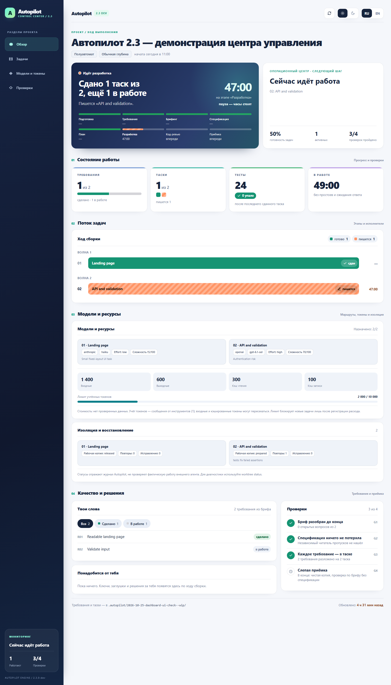
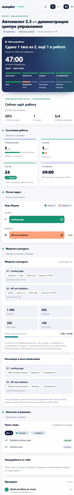
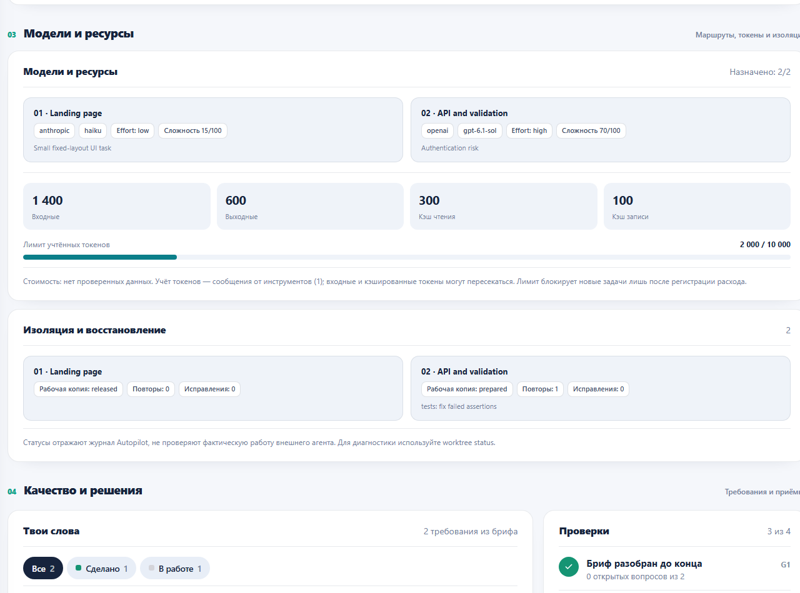

<h1 align="center">Autopilot 2.3 <sup>DEV</sup></h1>

<p align="center"><a href="https://github.com/mrAibo/Autopilot">GitHub: mrAibo/Autopilot</a></p>

<p align="center"><strong>Расскажи словами, что нужно построить — получи готовый проект.</strong></p>

<p align="center"><a href="README.md">English</a> · <b>Русский</b></p>

Autopilot — фреймворк разработки, skill, который берёт вашу идею, задаёт вопросы ровно там, где в ней есть развилки, а дальше сам пишет спецификацию, продумывает то, о чём вы не думали, разбивает работу на таски и собирает проект целиком. Вам не нужно читать спецификацию, оценивать таски или разбираться в коде.

Работает сам по себе: ставить что-то ещё не нужно.

> **Текущий статус и продолжение разработки:** [STATUS.md](STATUS.md). Здесь перечислены выполненные работы, непроверенные интеграции, актуальная ветка и инструкция для следующего чата.

> **Autopilot 2.3.0-dev** — версия разработки в основной ветке main. Новые возможности: [маршрутизация моделей](docs/autopilot/model-routing.md), [изолированные worktrees](docs/autopilot/worktrees.md), [проверка тестов на хосте](docs/autopilot/worktrees.md), [Dashboard 3.1](docs/autopilot/gui-clients.md) и [режим экономии токенов](docs/autopilot/optimization.md). Приложения [Codex и Claude Code](docs/autopilot/gui-clients.md) используют общий навык; графическая интеграция ещё проверяется. Это предварительная версия, не релиз. Текущее состояние — [STATUS.md](STATUS.md), требования — [бриф.md](бриф.md).

<p align="center">
  <a href="assets/ru/dashboard-31-desktop.png"></a>
  <a href="assets/ru/dashboard-31-narrow.png"></a>
</p>

<p align="center"><sub>Dashboard 3.1 · актуальный шаблон 2.3 · синтетические демонстрационные данные</sub></p>
<p align="center"><a href="assets/ru/dashboard-31-models.png"></a></p>

**И вы всё время видите, что происходит.** В начале сборки агент сам открывает дашборд — один HTML-файл, который не надо искать и запускать. Цвет шапки сразу говорит, что происходит: синяя — сборка работает, оранжевая — она ждёт вашего ответа, зелёная — сдано. Ниже — что делается прямо сейчас, сколько ещё осталось, каждый таск цветной полосой и каждое ваше требование вашими же словами. Таймеры идут вживую, страница обновляется сама, интернет не нужен.

---

**Для существующих проектов:** Dashboard 3.1 теперь отличается по структуре — боковая панель управления, текущая задача, метрики, модели и токены, качество и worktrees. Если ранее создавался файл .autopilot/dashboard.html, он не обновляется вместе с навыком; используйте безопасный инструмент skills/autopilot/tools/dashboard_upgrade.py --project <папка проекта>. Он сохраняет состояние и прежний HTML, после чего нужно обновить вкладку браузера.

**Новый контроллер для изолированных задач (предварительная 2.3):**
`.autopilot/controller.py --root .` сначала только показывает следующий
безопасный шаг, а `--advance` выполняет ровно один переход без обращения к модели.
Пример: `py -3.13 .autopilot/controller.py --root . --suite test_calc.py --advance`.
Переходы: prepare/start, после отдельно одобренного исполнителя — проверка
исходных тестов, финализация, Git-интеграция, приёмка и release.
Автозапуск платных агентов пока намеренно отключён. Подробности:
[Host controller](docs/autopilot/controller.md).

**Ограниченный цикл хост-контроллера:** команда
`.autopilot/host_loop.py --root .` только показывает следующий шаг; запуск
`--advance --max-steps 8 --suite 01=test_core.py` последовательно выполняет
безопасные Git/тестовые переходы и останавливается перед отдельным вызовом
AI-исполнителя. Сама команда модель никогда не запускает. Состояние
`tickets-settled` не равно итоговой приёмке G1–G4. Подробнее:
[host loop](docs/autopilot/host-loop.md).

**Офлайн-проверка P0:** отдельный [тестовый диспетчер](docs/autopilot/offline-supervisor.md)
запускает настоящий локальный процесс только в одноразовых временных Git-проектах.
Проверяются квитанция до запуска, запрет повторного вызова, отмена и тайм-аут.
Настоящие модели Codex/Claude этот инструмент **не запускает**, в обычные проекты
не устанавливается и не заменяет промышленный AI-диспетчер. На Windows добавлены
Job Object и запуск только после подтверждения изоляции; аварийное завершение
родителя проверено тестом. Для Linux/macOS такой гарантии пока нет.

**Финализация без коммита модели (P0):** если Codex успел изменить
файлы разрешённой зоны, но Windows sandbox запретил ему `git commit`,
теперь результат получает `ready-for-host-verification`, а не
ложный «успех». Независимые тесты запускает хост, он же создаёт коммит
и переносит его в основную ветку. Нет изменений или нарушена зона —
`incomplete`. [Подробности](docs/autopilot/codex-cli.md).

**Ограниченный Responses API пилот (P0):** добавлен отдельный
[тестовый API-маршрут](docs/autopilot/bounded-api-pilot.md) для
фиксированного синтетического задания. Объём запроса ограничен,
серверный лимит выходных токенов задан; отмена повторов обеспечена
квитанцией до HTTP-вызова. Полный Git-цикл проверен с имитированным
ответом API. На Windows **не найден OPENAI_API_KEY**, поэтому нового
реального платного вызова не было. Общий Codex CLI остаётся заблокирован.

**Безопасность платных вызовов (P0):** реальный короткий тест Codex CLI
зафиксировал 53 187 входных и 341 выходной токен при мягком пороге 2 000.
Поэтому и GUI-мост, и прямой Codex-диспетчер пока **запрещают платный запуск**:
лимит уже записанных токенов не ограничивает отдельный запрос у провайдера.
Остались read-only просмотр и [отчёт по токенам](docs/autopilot/spend-guard.md).
Скрытых флагов для снятия блокировки нет; офлайн-тесты используют только
локальные тестовые подмены.

**Новая интеграция с графическим Codex:** если нативные именованные
субагенты недоступны, GUI с разрешённым терминалом может использовать
[однократный CLI-мост](docs/autopilot/gui-cli-bridge.md). Команда
`.autopilot/gui_bridge.py --root . --ticket 01` сначала только
проверяет маршрут, модель, effort, Git-worktree и записанный бюджет.
Потенциально платный запуск требует явного согласия на конкретный билет
`--execute --approve-ticket 01`; перед вызовом фиксируется несбрасываемая
квитанция, чтобы после сбоя не запускать модель повторно автоматически.
Приёмка изменений по-прежнему требует самостоятельных тестов. Это
**не** подтверждённая нативная интеграция субагентов Codex GUI.

Новая проверка `gui_bridge.py --ticket NN --check-runtime` без расхода токенов сверяет версию Codex CLI, доступность назначенной модели/Effort и параметры запуска.

## Установка

> **Предварительная 2.3:** На текущем Windows-компьютере глобальные пути навыка для Codex и Claude уже связаны с исходниками этой ветки через Windows Junction. Повторно устанавливать или копировать навык не нужно. Команды `npx skills add` ниже для других пользователей устанавливают опубликованную версию из `main`, которая до релиза 2.3 может оставаться 2.2. Не запускайте `npx skills update -g` для 2.3-dev, подключённой ссылкой.

### Не хотите открывать терминал

Откройте своего AI-агента — Claude Code, Cursor, Codex — и вставьте ему этот текст:

```
Установи мне навык Autopilot. Выполни в терминале:

npx skills add mrAibo/Autopilot --skill autopilot -g -y -a <подставь себя: claude-code, cursor, codex>

Если npx не найдётся — дай мне ссылку, где скачать Node.js, и подожди.
Больше ничего не устанавливай.
Когда закончишь — напиши одной строкой, что готово и что надо перезапустить сессию.
```

Агент всё сделает сам. После этого перезапустите его — навыки читаются при старте.

Это команда для **первой** установки. Обновлять потом — [другой командой](#обновление-и-удаление).

### Через терминал

Скопируйте строку:

```bash
npx skills add mrAibo/Autopilot
```

Установщик спросит, какие навыки поставить и для каких агентов — просто подтвердите.

<details>
<summary>Установка одной командой, без вопросов</summary>

```bash
npx skills add mrAibo/Autopilot --skill autopilot -a claude-code -g -y
```

| Флаг | Что делает |
|------|------------|
| `--skill autopilot` | Ставит только Autopilot |
| `-a claude-code` | Ставит для Claude Code |
| `-g` | Глобально — навык доступен во всех проектах |
| `-y` | Не задавать вопросов |

Без `-g` навык встанет только в текущую папку проекта.

</details>

**Требуется:** [Node.js](https://nodejs.org) (для `npx`) и любой поддерживаемый AI-агент — Claude Code, Cursor, Codex и [70+ других](https://github.com/vercel-labs/skills#supported-agents). Больше ничего.

---

## Как пользоваться

Откройте агента в папке будущего проекта и напишите:

```
/autopilot Хочу телеграм-бота, который принимает заявки на ремонт техники
и складывает их в Google-таблицу
```

Autopilot включается **только этой командой**. Сам он не стартует, даже если вы написали «собери под ключ»: он создаёт репозиторий, пишет код и коммитит, и такое должно начинаться только по вашему слову.

**Если задача большая — напишите её в файл.** В одну строку чата подробное описание не помещается, а мельчить не надо: чем больше вы расскажете, тем меньше придётся додумывать за вас. Создайте рядом с проектом файл — название любое, `brief.md`, `идея.txt`, `задача.md` — и опишите там всё в свободной форме: что за проект, для кого, что должно уметь, что вам не нравится у конкурентов, какие есть ограничения по деньгам и срокам. Потом просто укажите на него:

```
/autopilot brief.md
```

```
/autopilot deep docs/идея.md только без оплаты картой
```

Агент прочитает файл и возьмёт его содержимое как задачу; ваш файл при этом останется нетронутым, а его копия ляжет в `.autopilot/` — именно с ней в конце сверяется результат. Слова, дописанные рядом с путём, идут в ту же задачу.

Дальше нужно будет только ответить на несколько вопросов в самом начале.

В ответ агент первым делом скажет, в каком режиме работает и какие есть ещё, и **сам откроет дашборд** — так что помнить команды и искать файлы не нужно:

```
Режим: полуавтомат · глубина: обычная — спрошу только то, что в задаче не определено, дальше соберу сам.
Дашборд открыл — обновляется сам: http://localhost:52814/dashboard.html
Память проекта — AGENTS.md (+ CLAUDE.md со ссылкой).

Можно переключить в любой момент, просто скажи:
• «полный автомат» — не спрашиваю вообще ничего
• «режим интервью» — разберу задачу вопросами до конца, дальше соберу сам
• «ручной режим» — то же плюс согласуешь спецификацию и список тасков
• «строго по брифу» / «проработай глубоко» — меньше или больше проработки сверх сказанного
```

Вопросы приходят **раундами**: несколько сразу, пронумерованные, у каждого — ответ, который агент выбрал бы сам. Согласны со всем — отвечаете «ок», не согласны с одним — «2 — таблица, остальное ок».

---

## Четыре режима

После `/autopilot` можно дописать, насколько плотно вы хотите участвовать. Ничего не написали — работает **полуавтомат**.

| Режим | Как включить | Что спрашивают у вас |
|---|---|---|
| **Полный автомат** | `/autopilot full ...` или «полный автомат» | Ничего. В конце — список решений, принятых за вас |
| **Полуавтомат** *(по умолчанию)* | ничего дописывать не нужно | Только то, что в задаче не определено: обычно один-два раунда вопросов. Всё однозначно — ни одного |
| **Интервью** | `/autopilot interview ...`, «режим интервью», «погриль меня» | Все развилки до одной, плюс то, где идея может не сработать. Дальше собирает сам |
| **Ручной** | `/autopilot manual ...` или «ручной режим» | То же, что в интервью, потом ваше «ок» на спецификацию и на список тасков |

```
/autopilot full лендинг для доставки пиццы

/autopilot Телеграм-бот для записи на маникюр

/autopilot manual CRM для автосервиса, хочу сам утвердить спецификацию
```

Слова `full`, `semi`, `interview`, `manual` пишутся без дефисов. Режим можно поменять по ходу — «переключись в ручной», применится со следующего этапа.

**Что не меняется ни в одном режиме:** агент спросит перед необратимым — публикацией, оплатой, рассылкой, удалением данных. И ни один режим не отключает сверку с вашей изначальной задачей.

---

## Глубина проработки

Отдельная ручка, независимая от режима. Режим решает, **сколько у вас спросят**; глубина — **сколько додумают за вас**.

| Глубина | Как включить | Что делает агент |
|---|---|---|
| **Строго** | `/autopilot strict ...` или «строго по брифу», «ничего не добавляй» | Только то, что вы написали. Никаких своих фич — даже хороших. Ошибки и пустые состояния всё равно обрабатываются: без них требование просто не работает |
| **Обычная** *(по умолчанию)* | ничего дописывать не нужно | Прорабатывает то, где пробел явно испортит результат. Своё добавить может, но с привязкой к вашему требованию |
| **Максимальная** | `/autopilot deep ...` или «проработай глубоко», «продумай за меня» | Каждое требование прогоняется по полному списку: первый запуск, пустой экран, неверный ввод, отказ, обрыв, рост, права, последствия |

```
/autopilot strict форма обратной связи, ровно как описал

/autopilot deep интернет-магазин керамики

/autopilot full deep маркетплейс мастеров
```

Порядок слов не важен, оба параметра необязательны. Глубину, как и режим, можно поменять по ходу: «поменьше отсебятины» или «продумай глубже».

**На любой глубине действует одно правило:** всё, что агент добавил от себя, привязано к вашему требованию и попадает в финальный отчёт отдельным списком. Фича, которая ни к чему не привязана, вырезается.

---

## Эталон — на что должно быть похоже

Если у вас есть сайты, приложения или тексты, на которые результат должен быть похож, — скажите об этом, когда агент спросит в брифинге. Они лягут в `reference.md` и уйдут тем агентам, которые строят то, что вы будете видеть: интерфейс сразу делается «как там», а не выравнивается потом. Свой вкус агент за ваш не выдаёт — эталон бывает только ваш.

---

## Две вещи, которые Autopilot делает иначе

### Ваша задача не теряется по дороге

Обычная проблема сборки «по описанию»: вы надиктовали большой бриф, дальше пошли вопросы, спецификация, таски, код — и на выходе половины из того, что вы просили, просто нет. Не потому что отказались, а потому что на каком-то шаге это перестало упоминаться.

Autopilot первым делом разбирает ваш текст на **пронумерованные требования** и записывает их дословно в файл. Дальше у каждого требования есть статус, и на каждом этапе стоит проверка:

- после спецификации — ни одно требование не осталось без раздела;
- после разбивки — у каждого требования есть таск, **и у каждого таска есть требование** (это ловит работу, которую никто не заказывал);
- в конце — **слепая приёмка**: отдельный агент получает только ваш исходный текст и готовый проект, спецификацию ему не дают. Он проверяет результат против ваших слов, а не против пересказа. Если он и трекер расходятся — вы увидите это в отчёте.

**Снять требование может только вы.** Агент вправе предложить отложить — вычеркнуть не вправе. Молчание отменой не считается.

### То, о чём вы не подумали, продумывают за вас

В брифе вы описываете, как всё работает, когда всё хорошо. Вы не описываете, что показать на пустом экране, что будет при обрыве связи, что случится, если нажать «отправить» дважды, и что видит человек в самый первый запуск. Это не упущение — это просто не тот уровень, на котором формулируют задачу.

Продумать это — большая часть ценности Autopilot, и объём этой работы вы задаёте [глубиной](#глубина-проработки). На обычной глубине агент закрывает пробелы, которые явно испортят результат; на максимальной — прогоняет каждое требование по полному списку. Что-то он решит сам (текст ошибки, разумные лимиты), а что-то, где решение действительно ваше, вынесет в вопросы.

На максимальной глубине одно требование из брифа разворачивается в несколько проработанных сценариев — столько, сколько у него реально есть сторон. Это и есть разница между «работает на демо» и «работает».

---

## Прогресс видно всегда

`.autopilot/dashboard.html` **открывается сам** в самом начале сборки — искать и запускать ничего не нужно. Если агент умеет показывать страницу внутри своего окна (например, панель в приложении Claude), дашборд откроется там, и всё останется в одном окне; иначе — во внешнем браузере. В узкой панели рядом с чатом он становится плотнее: те же блоки, но без гигантских цифр. Работает офлайн. Пока сборка идёт, страница сама подтягивает свежие цифры каждые десять секунд — не перезагружаясь, так что место на странице и выделенный текст не теряются; стрелка ⟳ вверху обновляет сразу. Рядом — переключатели темы (светлая / тёмная) и языка (RU / EN); пока тему не трогали, дашборд следует за системной.

**Шапка — что происходит одной фразой.** Синяя: сборка работает — «Сдано 2 таска из 6, ещё 3 в работе», какие таски пишутся, какие на проверке, и сколько осталось до сдачи вместе с ревью и приёмкой. Оранжевая: **сборка ждёт вас** — вопросы брифинга, «ок» на спецификацию в ручном режиме, решение перед необратимым шагом; вкладка браузера тоже говорит «● Ждём ответа», а часы сборки в это время стоят. Зелёная: сдано — что теперь есть и что нужно от вас, чтобы запустить по-настоящему. Под фразой — восемь этапов от подготовки до приёмки: пройденные, текущий, пропущенные.

**Ход сборки — у каждого состояния свой цвет.** Зелёный — таск сдан, оранжевый в полоску — пишется, бирюзовый — на проверке, фиолетовый — вернулся с ревью в ремонт, красный — не собрался, пунктир — ждёт своей очереди. Под полосой ремонта или проверки написано, почему. Таски сгруппированы по волнам: видно, что летит параллельно и чего ждёт следующая волна.

**Твои слова.** Каждое требование из брифа — вашей цитатой и с тем, что с ним стало: сделано, в работе, нужны ваши данные, отложено, снято вами. У отложенного и заглушки — причина. Это главное обещание Autopilot — ничего не пропадёт тихо, — и здесь его можно проверить глазами.


| Блок | Что показывает |
|---|---|
| **Требования** | Сколько ваших требований закрыто. Задачи бывают готовы на 100 %, а бриф — на 70 % |
| **Проверки G1–G4** | Бриф разобран до конца · спецификация ничего не потеряла · каждое требование в таске · слепая приёмка. Галочка ставится, когда проверка прошла |
| **Лента** | Последние события словами: таск сдан, ушёл на проверку, вернулся в ремонт, план сошёлся. Лучший ответ на «оно живо?» |
| **Понадобится от тебя** | Ключи для `.env`, заглушки на месте ваших данных, решения, принятые за вас |
| **Тесты и время** | Сколько тестов зелёные; рабочее время без простоев и без ожидания вашего ответа |
| **В отчёте** | Слепая приёмка и её расхождения, открытые вопросы, замечания ревью с адресом в коде |

Даже когда проект небольшой и собирается одним таском, дашборд заполнен так же: этапы, требования, тесты, коммит и заглушки. Если сессия оборвалась — напишите `/autopilot` без слов, агент поднимет состояние из файлов и продолжит с того места, где остановился.

---

## Проект помнит себя сам

Обычная беда второй сессии: агент открывает готовый проект и полчаса разбирается, что тут вообще построено, — за ваши же деньги. Autopilot закрывает это файлом описания проекта в корне — `AGENTS.md`.

Файл появляется **сразу**, ещё до первой строчки кода: название, команды запуска. Дальше туда попадает только то, что реально выяснилось по ходу — настоящая команда проверки, грабли, на которые уже наступили, новая переменная окружения. А в самом конце отдельный агент читает **готовый код** (не спецификацию — иначе описание рассказывало бы про планы) и пишет указатели: как запустить, где что лежит, где больно. У большого проекта архитектура уходит в `docs/architecture.md`, а решения с причинами — в `docs/adr/`.

| | |
|---|---|
| Какой файл | `AGENTS.md` — его читают Claude Code, Codex, Cursor и другие агенты. Рядом ложится `CLAUDE.md` с одной строкой `@AGENTS.md`: без него Claude Code пропустит `AGENTS.md`, если где-то выше по папкам лежит другой `CLAUDE.md` |
| У вас уже есть свой `CLAUDE.md` или `AGENTS.md` | Autopilot его **не трогает**. В конце он предложит, что дописать — новые команды, переменные, грабли, — и спросит, применить ли. В полном автомате предложение просто останется файлом |
| Объём | По размеру проекта и коротко: каждая строка этого файла читается в каждой следующей сессии |
| Ваш текст | Всё, что написали вы, — неприкосновенно. Autopilot пишет только внутри своих меток |

---

## Как это работает

Главный принцип: **порядок и есть продукт**. Код пишется в предпоследней фазе, всё до неё — выяснение, что именно строить, всё после — доказательство, что построили именно это.

| Фаза | Что происходит |
|---|---|
| **Подготовка** | Настройка папки проекта, `.gitignore`, приборы — дашборд открывается сразу |
| **Требования** | Ваш текст → пронумерованные требования, дословно |
| **Брифинг** | Вопросы раундами и только по реальным развилкам; первыми — те, без ответа на которые проект не собрать: оплата, хостинг, доступы |
| **Спецификация** | Требования разворачиваются в проработанные сценарии |
| **План** | Спецификация режется на таски — или не режется, если задача небольшая — и раскладывается на волны: что можно собирать одновременно, а что только по очереди |
| **Разработка** | Один таск = один отдельный агент с чистой памятью, один коммит; независимые таски идут параллельно |
| **Код-ревью** | В конце — всегда вся сборка целиком: соответствие брифу и спецификации, качество кода, безопасность. Отдельно и раньше — только первый таск, на котором строятся остальные, и таски про вход, ключи, деньги и удаление данных; такая проверка идёт параллельно и сборку не держит |
| **Приёмка** | Отдельный агент ставит проект с нуля в чистой копии, запускает и сверяет результат с вашей изначальной задачей; описание проекта на будущее; отчёт |

### Про нарезку на таски

Каждый таск — это отдельный агент, который заново въезжает в проект: читает контракты, изучает код, разбирается со стеком. Это стоит дорого. Поэтому Autopilot режет по объёму кода, а не «чем мельче, тем надёжнее»: один агент пишет около 3 тысяч строк вместе с тестами.

| Объём | Сколько тасков |
|---|---|
| До ~3 тысяч строк — лендинг, форма, скрипт, список правок в готовом проекте | **один.** Один агент собирает всё за один заход, как в обычном диалоге |
| ~3–6 тысяч | 2 |
| ~6–18 тысяч | 3–6, по одному на ~3 тысячи строк |
| ~18–36 тысяч | 7–12 |

Больше 12 — запрещено: работа разбивается на два запуска. Мелкая нарезка не покупает надёжность, она покупает расход.

У другого края тоже есть предел. На каждом шаге агент заново читает весь свой контекст из кэша, поэтому чем дольше идёт таск, тем дороже каждый следующий шаг. Около 3 тысяч строк — это примерно 300–400 тысяч токенов контекста: дальше свежий агент дешевле длинного.

### Про разработку

| Что делает Autopilot | Зачем |
|---|---|
| Каждый таск выполняет отдельный агент | Не путается в накопившемся контексте и не ломает то, что работало |
| Передаёт следующему агенту контракты предыдущих | Иначе шестая задача заново изобретёт то, что построила третья |
| Независимые таски идут параллельно, по нескольку агентов сразу | Ждать по очереди то, что не зависит друг от друга, — это часы на пустом месте |
| Один коммит на таск | Ваши точки отката |
| Таски с общими файлами идут по очереди | Иначе два агента перезапишут работу друг друга |
| Полный прогон проверки после каждого таска — тесты, типы, линтер | Регрессия стоит минуты, а не вечер |
| Рутинные таски — на модели попроще, фундамент и рискованные — на сильной | Платите за сильную модель там, где она что-то меняет |
| Ревью — в конце, а отдельно только фундамент и узкий список рисков; параллельно, без остановки сборки, и не больше одной перепроверки | Раньше ревью съедало до половины расхода, а проверка после каждого таска держала его по 15–40 минут; дефекты, ради которых стоит смотреть раньше, живут в фундаменте и в коде входа, ключей, денег и удаления |
| Правки после ревью делает тот же агент, который писал код | Он помнит, почему код такой; чужой чинит симптом и ломает причину |
| Главный диалог не пишет код вообще — только раздаёт и сверяет | Его контекст один на весь запуск и не обновляется: каждый дифф, прочитанный на втором таске, мешает на восьмом |
| Упавший таск — повтор, потом попытка другим способом | Если и она не прошла, агент останавливается и объясняет по-человечески |
| План, который разошёлся с кодом, исправляется вслух | Если по ходу выяснилось, что задуманное не работает, агент правит план и говорит вам одной строкой — а не строит молча что-то другое |

---

## Когда использовать, а когда нет

**Подходит, если:**

- вы описываете, что нужно, и ждёте готовый результат;
- вы не программист и не будете читать спецификации и код;
- «собери под ключ», «just build it», «не задавай лишних вопросов»;
- вы хотите утвердить спецификацию и список тасков, но не возиться с процессом — это ручной режим.

**Не подходит, если:**

| Ситуация | Что делать вместо |
|---|---|
| Хотите писать код вместе, строчка за строчкой | Работайте с агентом напрямую |
| Задача — правка в одном файле | Просто попросите её сделать |
| Идея больше одного проекта, конечная цель неясна | Сначала определитесь с целью |

---

## Ключи, пароли и доступы

Autopilot **никогда не спрашивает ключи, токены и пароли** — только каким сервисом вы хотите пользоваться и есть ли у вас там аккаунт.

- вопрос будет «принимаем оплату через Stripe или ЮKassa?», а не «пришлите ключ»;
- в коде появится имя переменной — `STRIPE_SECRET_KEY`, значение вы вписываете в `.env` сами;
- `.env` сразу в `.gitignore`;
- в отчёте — список переменных, которые осталось заполнить, именами без значений.

Если вы всё-таки пришлёте ключ в чат, он **не попадёт ни в один файл**: перед записью весь ваш текст проходит через фильтр, который распознаёт ключи Stripe, GitHub, AWS, Google, Slack, токены Telegram, JWT и строки подключения. Вместо значения в файл уйдёт `[REDACTED:STRIPE_SECRET_KEY]`, а вам придёт предупреждение — ключ, побывавший в переписке, стоит отозвать и выпустить новый.

---

## Чего Autopilot не делает никогда

- не пишет код до того, как появилась спецификация;
- не вычёркивает ваши требования — только вы;
- не выдумывает факты о вас: цены, тексты и адреса останутся видимыми заглушками, а не правдоподобной ложью;
- не просит вас проверять задачи, их размер или код;
- не запускает две задачи в одной памяти агента;
- не оставляет оплату, доступы и хостинг на финиш;
- не просит и не сохраняет ваши ключи и пароли;
- ничего не устанавливает и не скачивает без вашего ведома.

---

## Обновление и удаление

**Обновляет только `update`.** Не переустанавливайте навык командой из раздела «Установка» — она для первой установки; для обновления есть отдельная команда:

```bash
npx skills update autopilot -g
```

Флаг `-g` — если навык ставился глобально. Для проектной установки запустите команду без флага в папке того проекта.

Не хотите открывать терминал — вставьте агенту:

```
Обнови навык Autopilot до последней версии. Выполни в терминале:

npx skills update autopilot -g

Если он ответит, что всё уже обновлено, а версия при этом старая — переустанови:
npx skills remove autopilot -g -y && npx skills add mrAibo/Autopilot --skill autopilot -g -y -a <подставь себя: claude-code, cursor, codex>

Когда закончишь — напиши одной строкой, что обновилось, и напомни перезапустить сессию.
```

Посмотреть, что установлено, и удалить:

```bash
npx skills list
```

```bash
npx skills remove autopilot -g
```

**Если навык ведёт себя как старая версия.** `update` сверяет версию источника, а не файлы на диске: если локальную копию правили или она побилась, он ответит «всё уже обновлено» и ничего не сделает. Лечится переустановкой:

```bash
npx skills remove autopilot -g -y && npx skills add mrAibo/Autopilot --skill autopilot -g -y -a claude-code
```

Чтобы агент увидел новую версию, **перезапустите сессию** — навыки читаются при старте.

### Как узнать, что вышла новая версия

В начале каждой сборки Autopilot сверяет свою версию с этим репозиторием и, если вышла новая, пишет одной строкой, что обновиться и какой командой. Что изменилось — в [CHANGELOG.md](CHANGELOG.md). Посреди сборки навык не обновляется никогда.

Проверка — один запрос к GitHub за сборку, без передачи каких-либо данных; без интернета она молчит. Выключить: переменная окружения `AUTOPILOT_NO_UPDATE_CHECK=1`.

---

## Что внутри репозитория

```
skills/autopilot/
├── SKILL.md                    ← оркестратор: порядок фаз, гейты, правила, которые не нарушаются
├── phases/                    ← правила фаз, читаются по одной, в момент фазы
│   ├── 0-modes.md              режимы и глубина, стартовое сообщение
│   ├── 0-preflight.md          подготовка репозитория
│   ├── 0-resume.md             продолжение прерванной сборки
│   ├── 0-instruments.md        дашборд: запуск и одна команда на каждое событие
│   ├── 0-memory.md             выбрать файл памяти проекта
│   ├── 1-manifest.md           бриф → требования, фильтр секретов
│   ├── 2-briefing.md           вопросы раундами, эталон
│   ├── 2-adversarial.md        где идея может не сработать — в интервью и на глубокой проработке
│   ├── 3-spec.md               спецификация и проработка глубины
│   ├── 4-plan.md               разбивка на таски по объёму, волны, кому ревью и какая модель
│   ├── 5-subagents.md          агенты-исполнители и контракты между ними
│   ├── 5-repair.md             ремонт и отказ — только когда таск вернулся не чистым
│   ├── 6-review.md             точечное ревью и ревью всей сборки
│   ├── 8-final.md              слепая приёмка и отчёт
│   ├── 9-memory.md             описание проекта и решения
│   ├── rationalizations.md     отговорки и красные флаги — проверка, а не инструкция
│   └── dashboard-template.html готовый дашборд с вшитым логотипом
├── prompts/                   ← материал для субагентов, не для оркестратора
│   ├── executor.md             как писать код и тесты, что вернуть
│   └── review.md               по чему судит ревьюер: три оси и безопасность
└── tools/
    └── ap.py                   учёт сборки: состояние, дашборд, сервер — одна команда на событие

docs/autopilot/design.md         ← почему устроено именно так, с замерами
tools/measure-run.py             ← замер реального прогона по логам Claude Code
CHANGELOG.md                     ← что нового по версиям
```

Файлы `phases/` читаются агентом по одному, только когда начинается соответствующая фаза, — поэтому в памяти всегда лежит ровно то, что нужно сейчас. Всё, что нужно лишь в редком случае, — ремонт, продолжение, разбор идеи на прочность, — вынесено в отдельные файлы и не открывается, пока случай не наступил. Обоснования решений живут в `docs/`, а не в инструкциях: агенту они не нужны, а платить за них пришлось бы на каждом шаге.

Всё это обычный markdown. Можно открыть и прочитать: [skills/autopilot/SKILL.md](skills/autopilot/SKILL.md).

---

## Лицензия

Проект основан на идеях [исходного Autopilot](https://github.com/nick-vels/skills) и развивается независимо. Первоначальное уведомление об авторских правах сохранено в [MIT LICENSE](LICENSE) в соответствии с условиями лицензии.
